# Analizando un Infostealer

No pude hacer andar la version 2.4 de Security Onion, asi que hice el TP con la Security Onion del curso de Cisco.

> Primero: ¿Qué es un Infostealer?

Un **infostealer** es un tipo de malware diseñado para infiltrarse silenciosamente en un sistema, recolectar datos sensibles (contraseñas guardadas en navegadores, archivos personales, etc) y exfiltrarlos hacia servidores de Comando y Control.

## Laboratorio Práctico:

Descargo e importo el .pcap `2024-09-19-file-downloader-to-Lumma-Stealer.pcap`

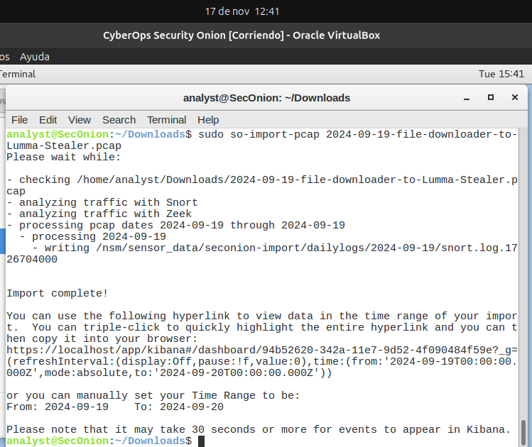

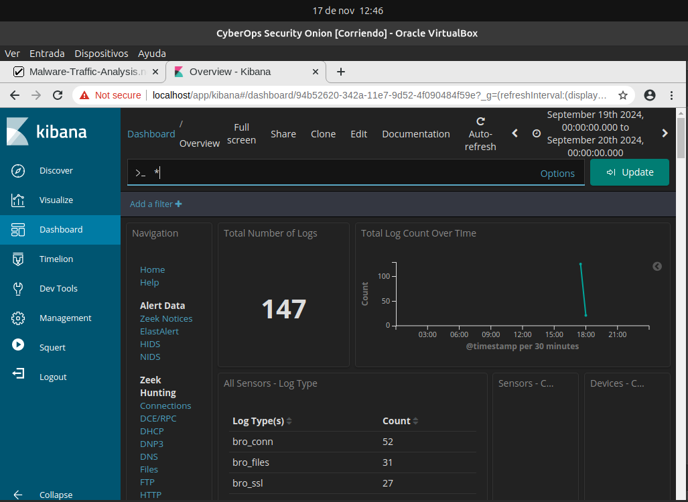

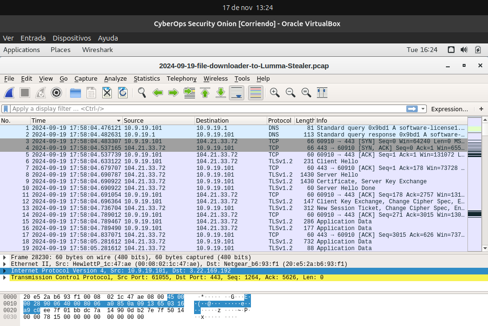

Fecha y hora del incidente: 19 de septiembre de 2024, entre las `17:58` y las `18:04` Horas.

> Analizar tráfico sospechoso (HTTP POST, DNS, User-Agent).

- Peticiones HTTP GET desde `10.9.19.101` (host infectado)

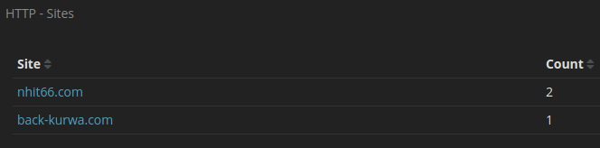

Busqué los URL en `VirusTotal` y ambos están catalogados como maliciosos:

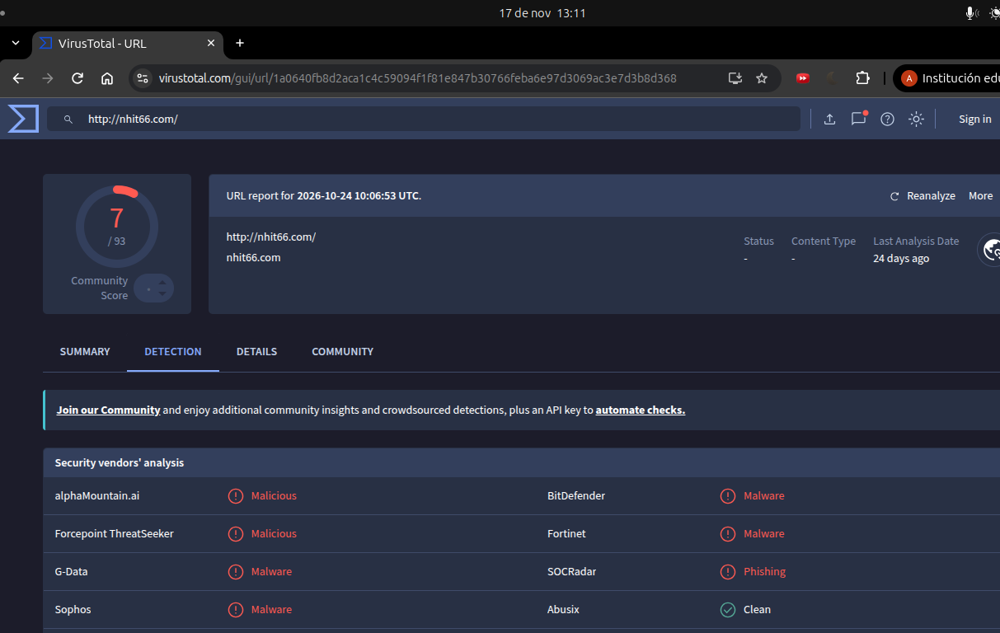

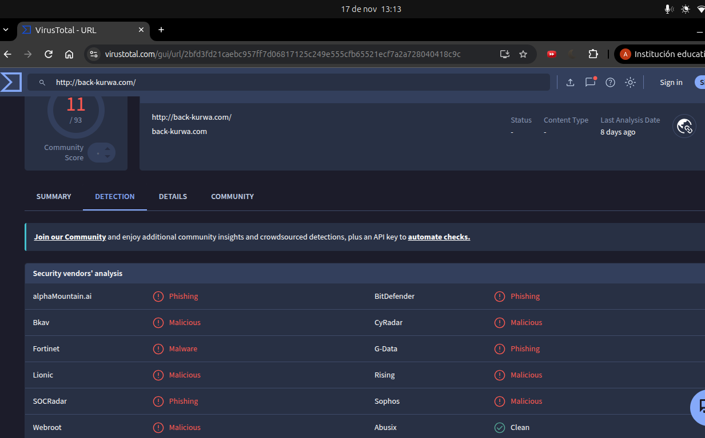

- HTTP-URIs:

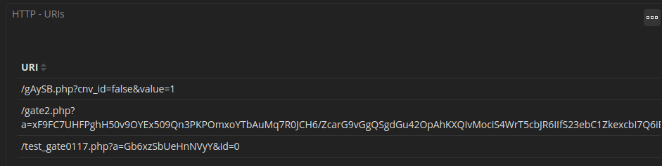

- HTTP-User Agent:

- En una de las consultas a `nhit66.com`, se logra ver que hubo una respuesta de 2204 bytes:

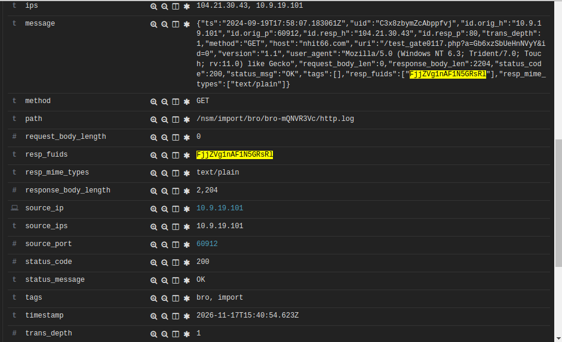

- Interacciones DNS:

Se registraron 24 consultas DNS desde `10.9.19.101` hacia `10.9.19.1`:

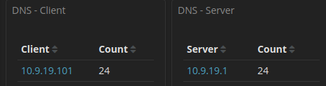

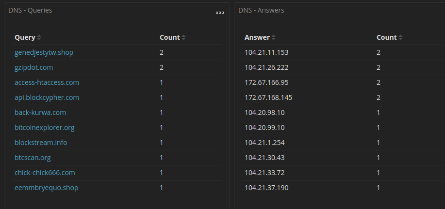

> También se identificaron dominios maliciosos:

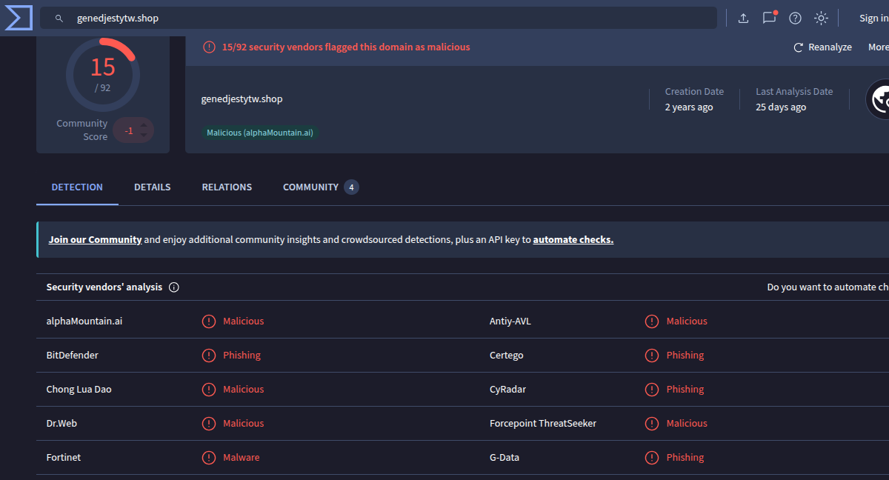

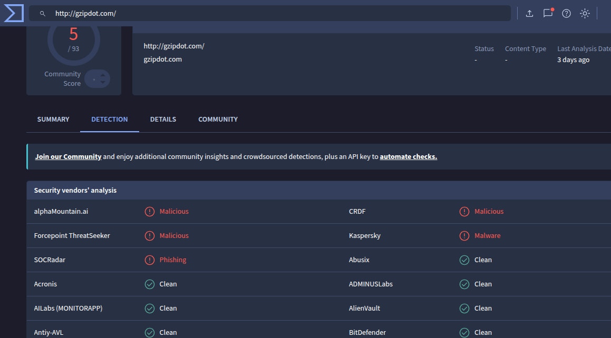

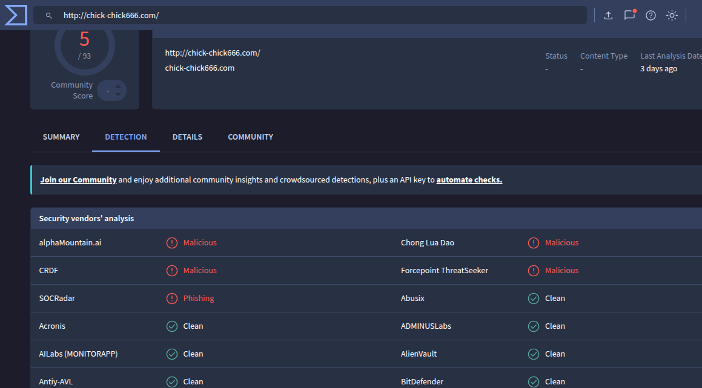

- Files: 

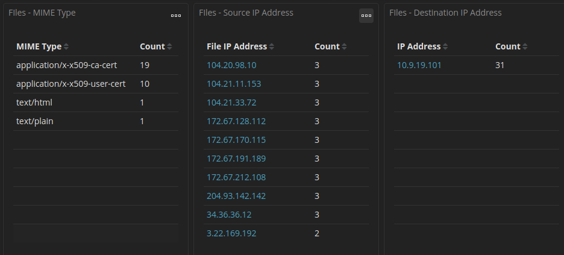

- Punto en el que se podria haber dado la descarga del infostealer:

> Busco en wireshark `statistics->conversations->TCP`, y ordeno por `bytes B-->A`:

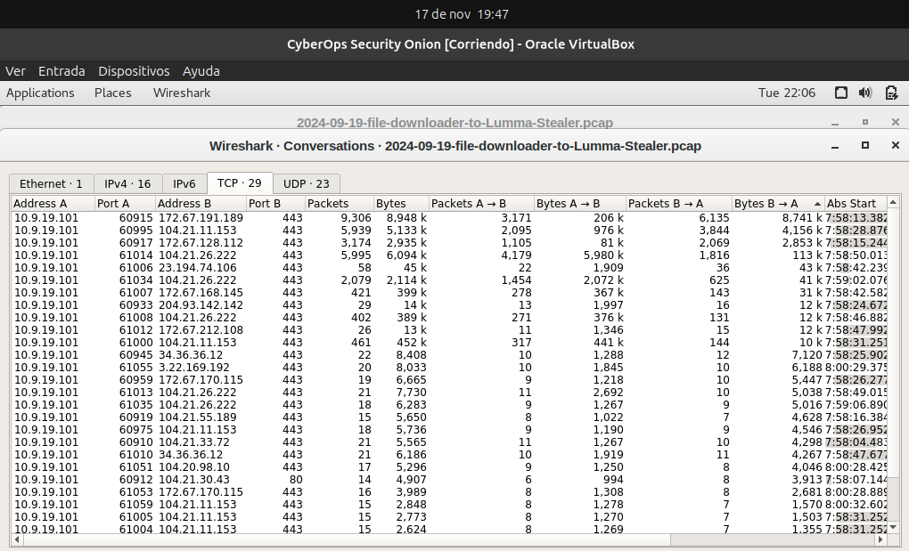

> Por el tamaño de datos que se pasan entre el equipo infectado y el servidor (`bytes B-->A`), y tambien se ve que desde el host pasa datos al servidor, ahí se podria estar dando la exfiltración (`bytes A-->B`).

## Indicadores de Compromiso (IOCs)

| IOC | Indicador |  Validación |
| --- | --------- | ----------- | 
| URL | `http://nhit66.com/` | Malicioso / Phishing en VirusTotal |
| URL | `http://back-kurwa.com/` | Malicioso / Phishing en VirusTotal |
| Dominio | `genedjestytw.shop` | Resuelto por el DNS y figura Malicioso en VirusTotal |
| Dominio | `gzipdot.com` | Resuelto por el DNS y figura Malicioso en VirusTotal |
| Dominio | `chick-chick666.com` | Resuelto por el DNS y figura Malicioso en VirusTotal |

## Explicación breve del proceso usado

- Inspeccioné los registros generados por **Zeek Hunting** : HTTP, DNS, Files.
- En **Kibana** identifiqué el host comprometido (`10.9.19.101`), las peticiones HTTP iniciales (`nhit66.com` y `back-kurwa.com`) y las consultas DNS.
- En **Wireshark**, busqué el flujo de la respuesta de 2.204 bytes que figuraba en los logs de HTTP  y luego revisé las conversaciones TCP para intentar encontrar el momento de descarga del ejecutable (no lo pude ver al estar cifrado pero por el tamaño del archivo podria ser el ejecutable).
- Para validar si los dominios y URLs eran maliciosos los busque en **VirusTotal**.

## Medidas de Mitigación

- Aislar el equipo `10.9.19.101`.
- Formatear o reinstalar el sistema operativo 
- Rotar todas las contraseñas y tokens de sesión en el host.
- Bloquear en DNS y Firewall todos los dominios maliciosos identificados.
