# Protección de Terminales

### Análisis de seguridad de hosts Linux con Lynis, OpenVAS y una distribución orientada a seguridad.
---

Para el desarrollo de la primera parte del laboratorio, se utilizó como sistema objetivo la máquina virtual `Cybersecurity Lab VM`.

Antes de hacer con la auditoría con Lynis, se ejecutaron los **Comandos Ubuntu** del enunciado.

---

### Identificación & Sockets

```bash
# 1. Verificar versión exacta del Kernel y OS
uname -r && lsb_release -a
```


> La VM usa **Ubuntu 22.04.1 LTS** con la versión de kernel **5.15**.

```bash
# 2. Auditar sockets TCP/UDP en escucha con PID/Proceso
sudo ss -tulpn
sudo netstat -l -p
```


```bash
# 3. Listar archivos y sockets abiertos por red
sudo lsof -i -P -n | grep LISTEN
```
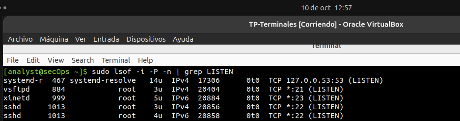

> Hay servicios escuchando en la red, como  **Telnet (puerto 23)** y **FTP (puerto 21)**.

```bash
# 4. Servicios habilitados al inicio del sistema
systemctl list-unit-files --state=enabled --type=service
```
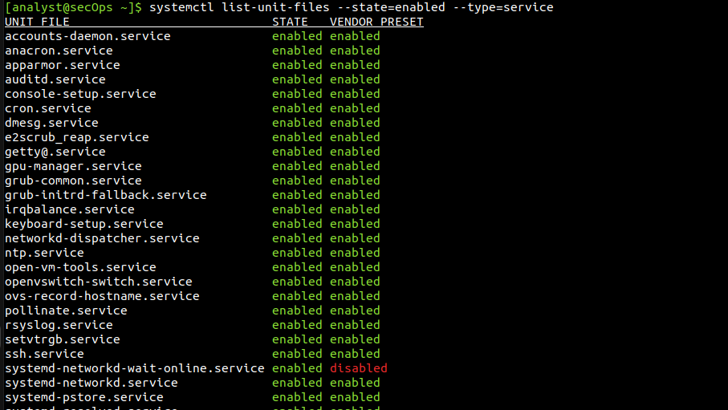

> La superficie de ataque puede reducirse, hay muchos servicios habilitados al inicio del sistema

```bash
# 5. Prueba de conexión manual
nc -zv 127.0.0.1 22
printf "GET / HTTP/1.1\r\nHost: www.google.com\r\nConnection: close\r\n\r\n" | nc www.google.com 80
```


> La conexión manual anda correctamente.

### Configuración UFW (Uncomplicated Firewall)

```bash
# Estado detallado de UFW
sudo ufw status verbose

# Configurar política por defecto
sudo ufw default deny incoming
sudo ufw default allow outgoing

# Permitir SSH restrictivo por IP/Subred
sudo ufw allow from 10.0.2.0/24 to any port 22 proto tcp

# Inspeccionar reglas traducidas en nftables
sudo nft list ruleset | head -n 20

```

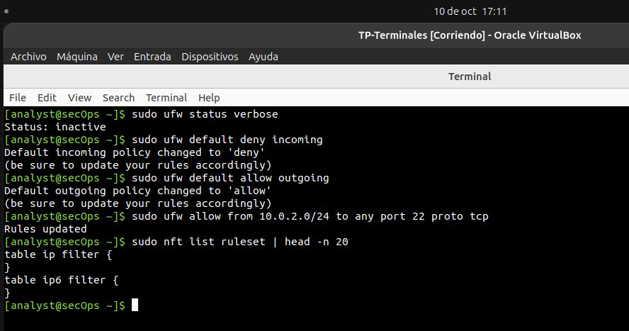

>  El firewall figura inactivo, luego se escribieron reglas para denegar todo el tráfico entrante y permitir solo SSH desde una IP específica (primero verifico la subred que tengo con `ip address`). 

### Verificación HIDS & MAC 

> HIDS: Host-based Intrusion Detection System.

```bash
# 1. Estado de perfiles AppArmor
sudo aa-status
```
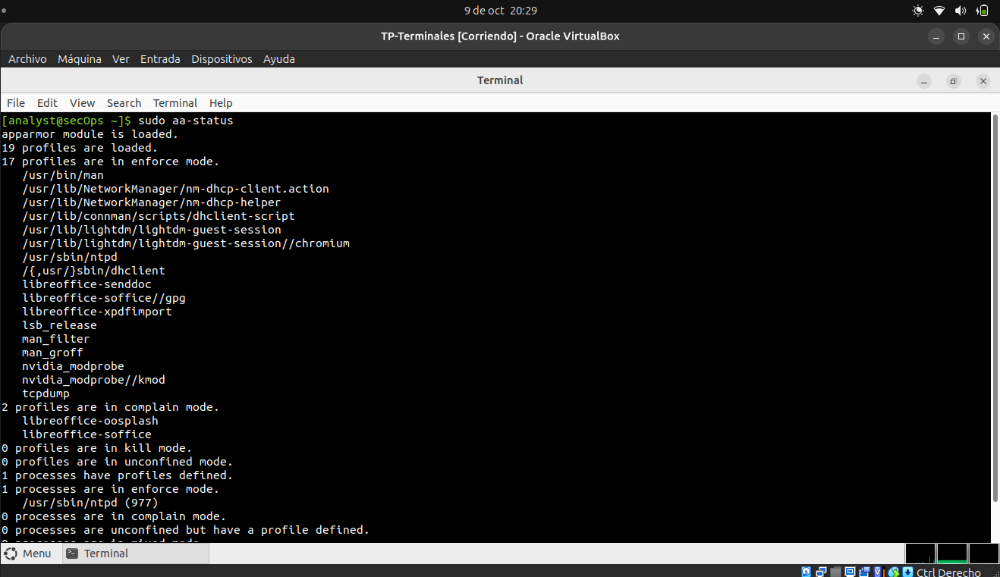

> AppArmor está activo y funcionando.

```bash
# 2. Reglas activas del subsistema de auditoría
sudo apt-get install auditd audispd-plugins
sudo auditctl -l

# 3. Inicializar / Verificar AIDE (File Integrity)
sudo aideinit && sudo aide --check

# 4. Estado del agente Wazuh (si está desplegado)
sudo systemctl status wazuh-agent
```


> El sistema no tiene reglas de auditoría cargadas, y tampoco tiene las herramientas de monitoreo AIDE y Wazuh.

---

## Lynis

Primero actualizo los paquetes del sistema e instalo Lynis:
```bash
sudo apt update
sudo apt install lynis
lynis --version
```

Ejecuto Lynis y guardo la salida para comparar después.
```bash
sudo lynis audit system
sudo cp /var/log/lynis-report.dat /var/log/lynis-report-before.dat
```


#### Resultado inicial

Se ejecutó auditoría con Lynis. La herramienta realizó 267 pruebas y obtuvo un índice hardening de 58, identifico 3 advertencias y 59 sugerencias de mejora.

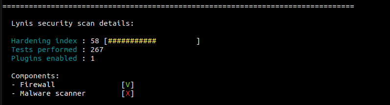

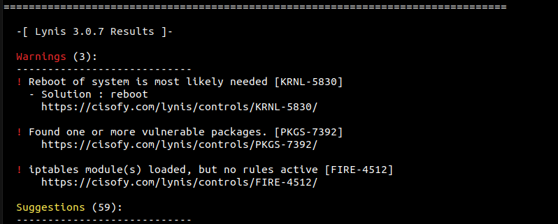

#### Detalles de las advertencias

Las advertencias indican la necesidad de reiniciar el sistema,
que hay actualizaciones de seguridad pendientes y que las reglas del firewall estan cargadas pero no activas.

Dentro de los servicios de red habilitado que no son necesarios encontro a Telnet y FTP que ya nos figuraban en la lista de sockets abiertos por red.

#### ¿Por qué representan un riesgo?

Al no tener el firewall activo la superficie de ataque queda totalmente expuesta, permitiendo que cualquier puerto abierto en el host sea accesible sin restricciones desde la red.
Telnet es un protocolo que no utiliza cifrado (por lo tanto es inseguro), esto puede permitir ataques de tipo *Man-in-the-Middle* (MitM) o captura de tráfico (*sniffing*).


#### Reparación

Para mitigar las advertencia voy a habilitar UFW, cerrar el puerto Telnet y rebootear el sistema.

```bash
# Habilitar el firewall UFW
sudo ufw enable

# Deshabilitar el servicio Telnet (xinetd)
sudo systemctl stop xinetd
sudo systemctl disable xinetd
# Compruebo que no figure el puerto 23
sudo lsof -i -P -n | grep LISTEN

# Reboot
sudo reboot
```
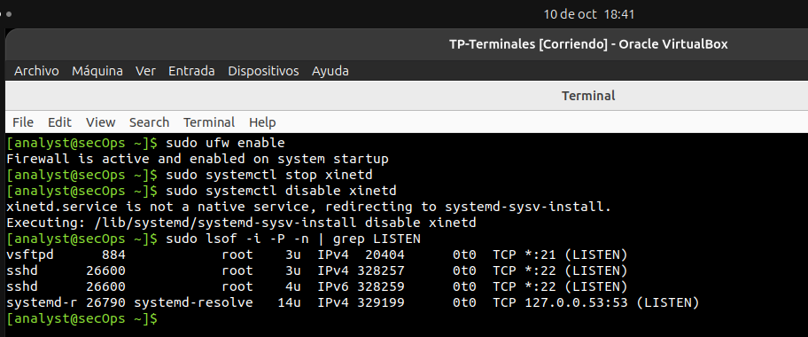


Luego del reboot ejecuto de vuelta la auditoria de lynis y comparo los reportes.

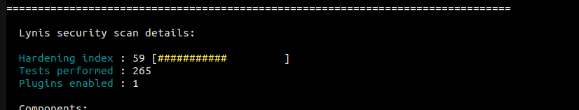

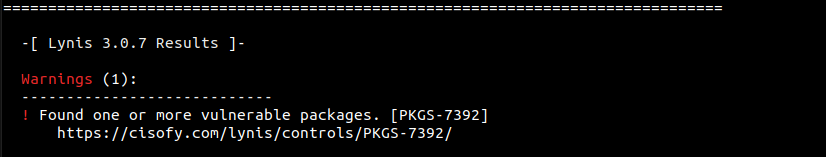

Se redujeron las advertencias y el indice hardening subio un punto.

> ¿La corrección tuvo algún impacto sobre la disponibilidad o funcionalidad del host?

No, la corrección no generó ningún impacto negativo sobre la disponibilidad ni sobre la funcionalidad del host.

---

## OpenVas

Para esta parte voy a utilizar dos maquinas virtuales, la misma que utilice para Lynis y una de OpenVas, que se descarga desde la página de Greenbone.

#### Inicio la maquina con OpenVas y voy siguendo los pasos para crear un usuario.

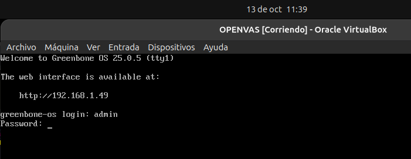  

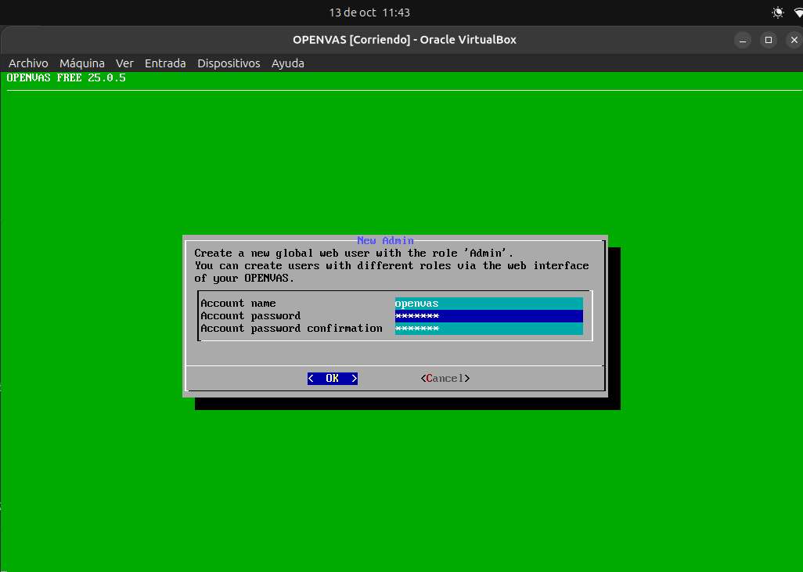

Para corroborar que hubiese conexión entre las dos maquinas virtuales hice un ping desde la Lab VM hacia la de OpenVas.

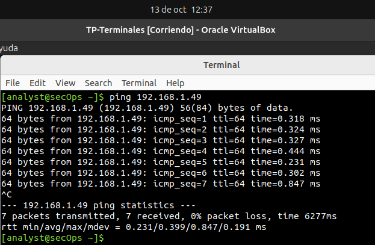

Accedo a la interfaz web de OpenVas desde Lab VM, con el usuario creado anteriormente.

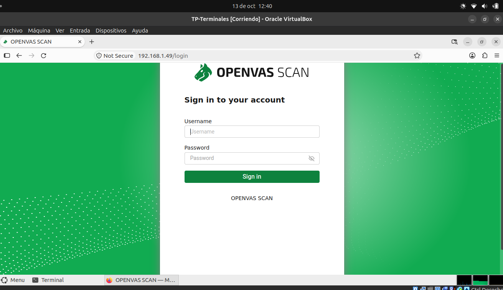

En la interfaz genero una Credencial para ssh, un Target y una Task para evaluar a Lab VM.

#### Credential con username y password de Lab VM
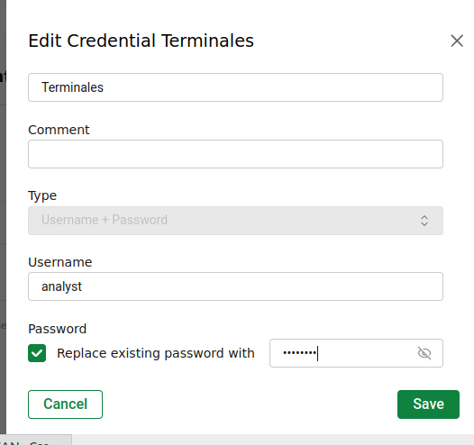

#### Target con la IP de Lab VM y credencial asociada

|ip: `192.168.1.50` | credential: `ssh port 22` |
| :------------------------ | :--------------------- | 
|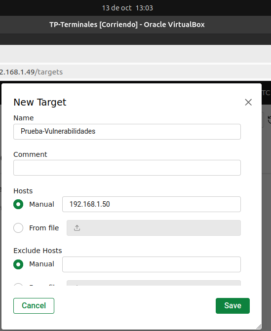   | 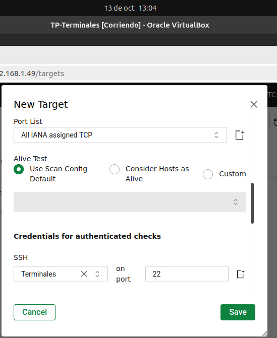 |

#### Task `Vulnerabilidades` con Target asociado `Prueba-Vulnerabilidades`

| | |
| :------------------------ | :--------------------- | 
|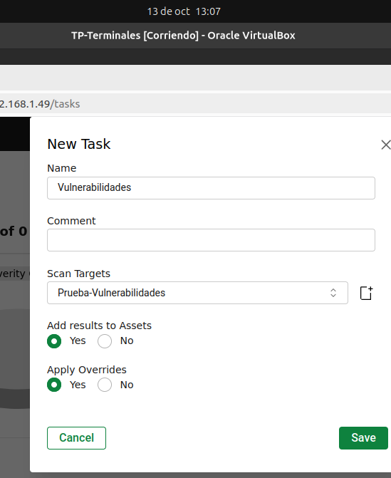  |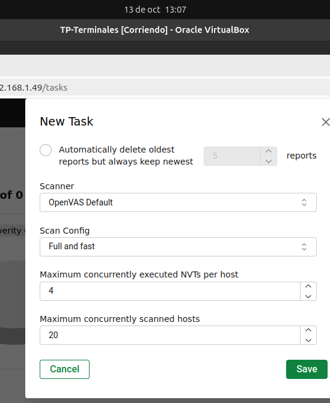|

Ejecuto la task y se analiza Lab VM.
> En Lab VM necesite deshabilitar el firewall, sino no podia ingresar a través de ssh.

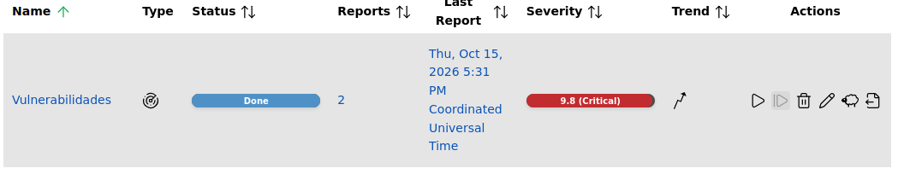

El reporte arroja el nivel de serevidad (Severity)y la cantidad de vulnerabilidades.

Hay 4 vulnerabilidades criticas, y 30 altas.
Para la remediación tome la vulnerabilidad más critica que figuraba, y dentro de las altas se repetian poblemas con wireshark.  
Ambas soluciones eran actualizar los paquetes.

Dentro de Lab VM hice un update de los paquetes y actualice solamente los dos que eleji. 

```bash
sudo apt update
sudo apt install --only-upgrade openvswitch-common wireshark -y
```

Después de que termino lance de nuevo la Task de OpenVas para generar otro informe.

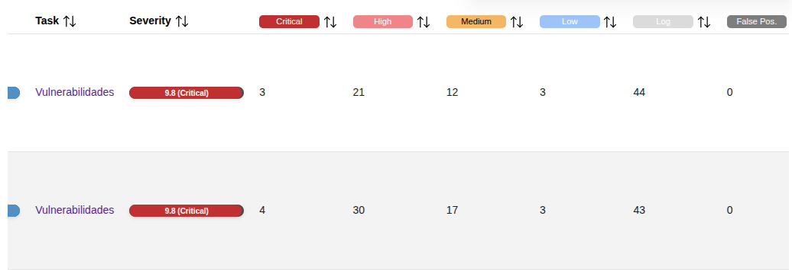

Se logra ver la cantidad de vulnerabilidades criticas bajo a 3 (ya no está la de `openvswitch-common`), y las altas pasaron a 21 (ya no hay vulerabilidades sobre `wireshark`). 


#### Comparación grafico de torta
| **Antes** | **Después** |
| :----------------------------------- | :-------------------------------- | 
|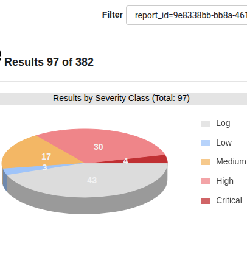| 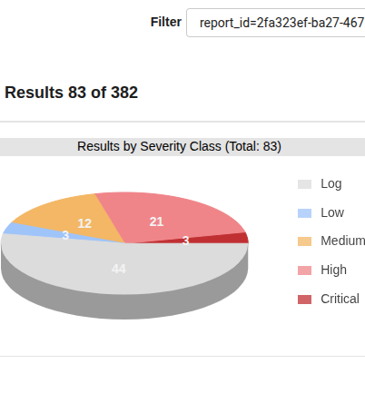|

---

## Kali Linux

Para la tercera parte voy a usar una VM de Kali Linux para analizar la Lab VM.

#### Escaneo de puertos TCP

```bash
sudo nmap -sS -sV -O -p- 192.168.1.50 -oA target_scan
```
[](img/kali/puertos-TCP.png)

El escaneo confirma la exposición del servicio FTP (puerto 21) y SSH (puerto 22). 

#### Auditoría de vulnerabilidades con scripts NSE

```bash
sudo nmap --script vuln 192.168.1.50
```
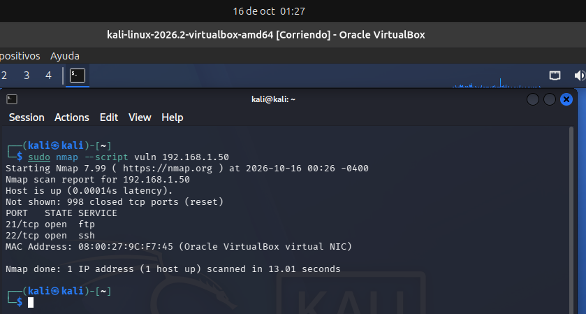

Analiza los dos puertos expuestos pero no encuentra vulnerabilidades.
La auditoría termina siendo peor que la local y la externa pero usando credenciales.
Intente setearle credenciales para ssh pero el resultado no cambió.
```bash
sudo nmap -p 22 --script vuln --script-args ssh.user=analyst,ssh.pass=cyberops 192.168.1.50
```
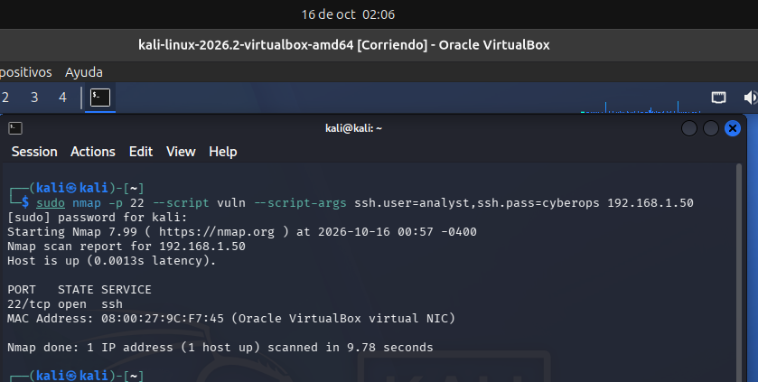

#### Escaneo de servicios web expuestos
```bash
sudo nikto -h http://192.168.1.50
```
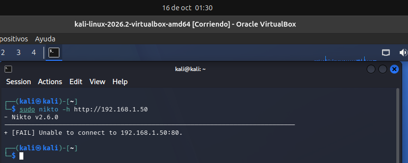

Falla porque no hay servicios web expuestos en el puerto 80.

#### Escaneo de cifrados TLS/SSL débiles

No tenia `testssl` la VM, lo descague desde el github para poder ejecutarlo.

```bash
git clone --depth 1 https://github.com/drwetter/testssl.sh.git
cd testssl.sh
./testssl.sh 192.168.1.50:443
```
> El flag `--depth 1` es para no descargar todo el historial de commit, solo el último.

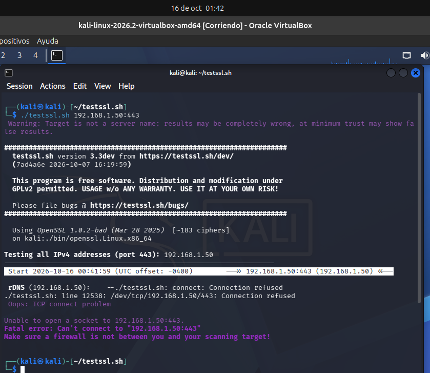

También falla porque no hay un servicio ssl en el puerto 443.

---

### Conclusión:

En primera instancia usaria Lynis, me dio buena cantidad de información y la puntuación del hardening, que si bien no garantiza de que no haya vulnearabilidades pero te da cierta referencia de seguridad.

OpenVas es más potente, el informe que genera el analisís me parecio bastante especifico, pero termino siendo mucho más laborioso y me consumio muchos recursos. Quizás para uso personal no lo usaría.

El analisís con Kali fue muy pobre, no me dio nada nuevo con respecto a Lynis y para encontrar vulnerabilidades en la Lab VM no sirvio.
