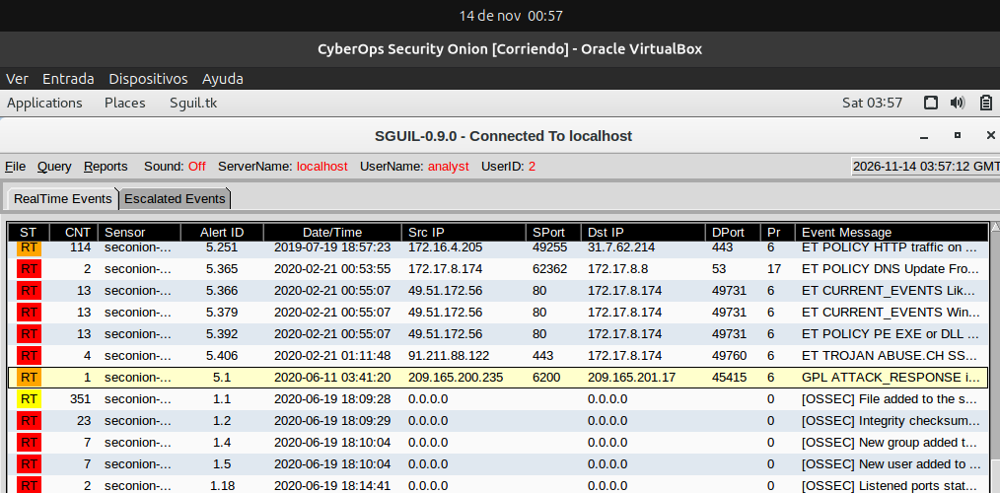
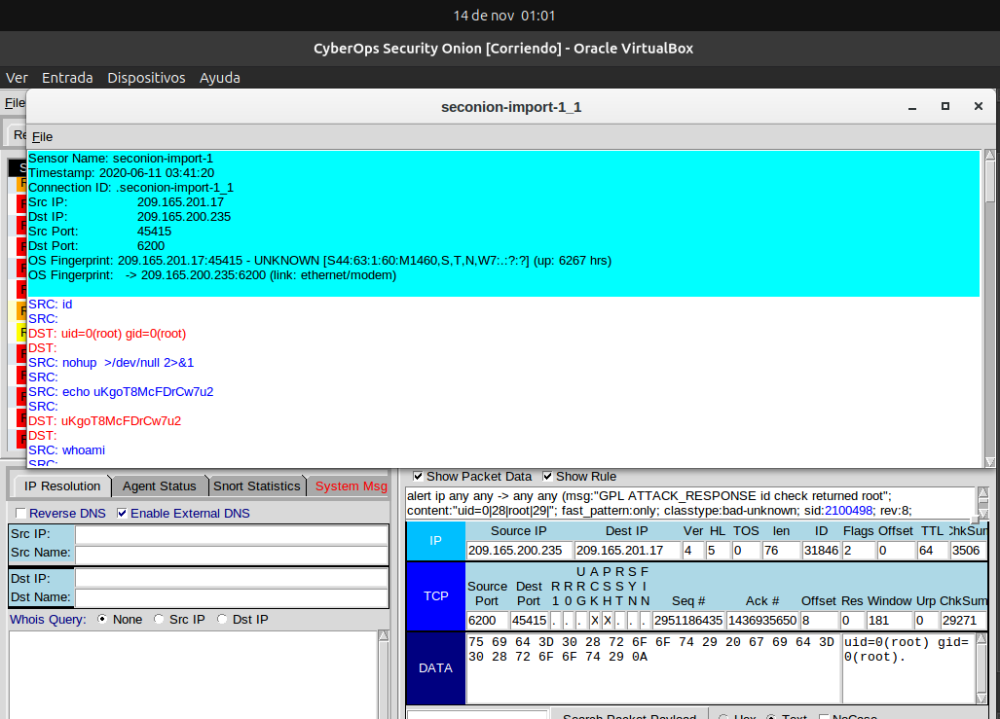
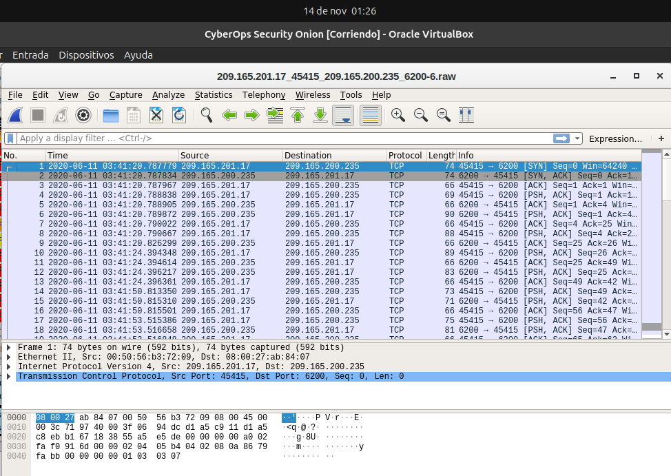
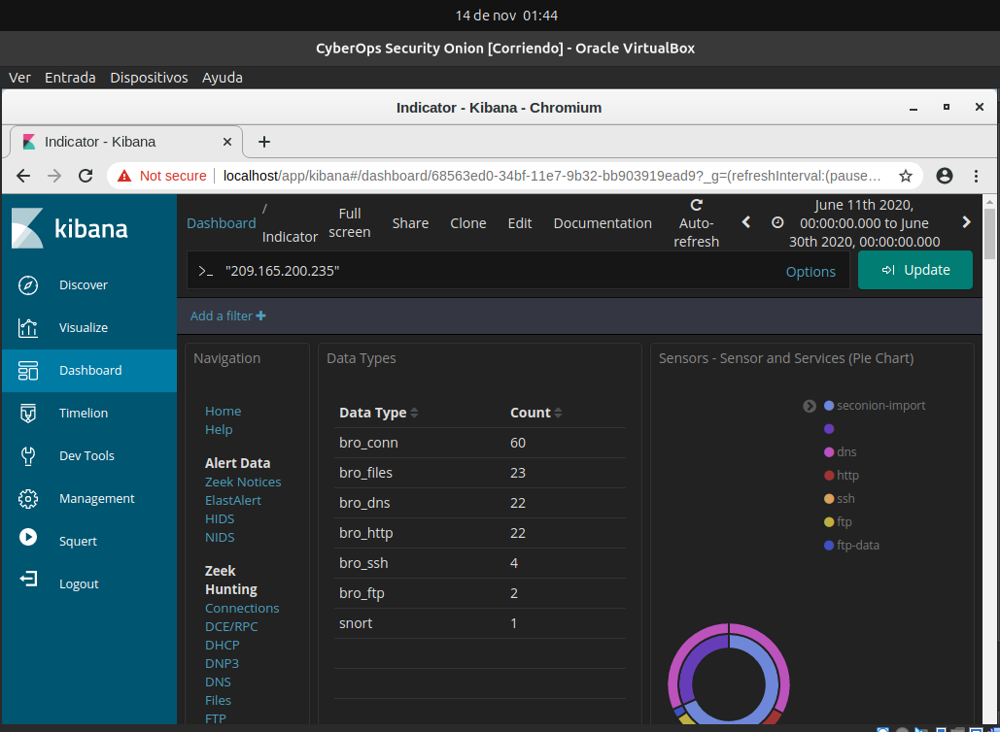
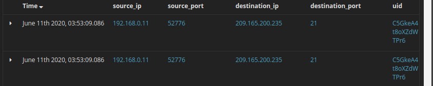
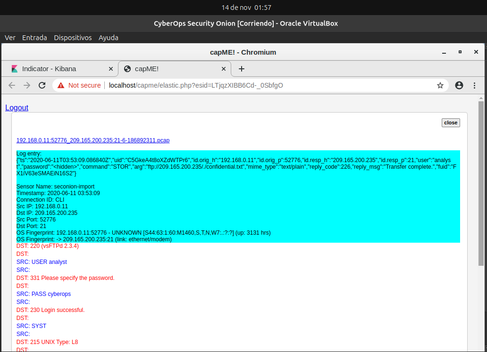
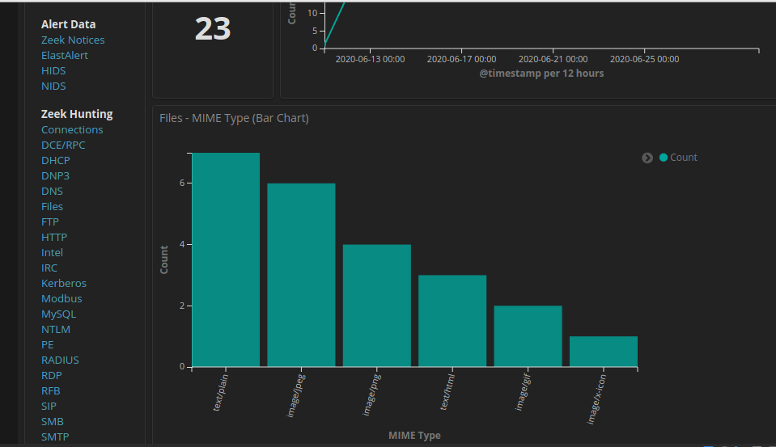

# Aislar hosts afectados con el método de cinco tuplas

## Parte 1: Revisar alertas en Sguil

> Inicio de sesión en Sguil:

> `Transcript`, `Show Packet Data`, `Show Rule`:

> ¿Qué tipo de transacciones ocurrieron entre el cliente y el servidor en este ataque?

Primero el atacante hace un reconocimiento, empieza ejecutando `whoami`, `hostname`, `ifconfig`, y el servidor responde dándole información.
Luego hace un cat de `/etc/shadow` (donde estan los hashes de contraseñas) y agrega uno como `myroot`.
Hace lo mismo con `/etc/passwd` (donde estan las cuentas del sistema).
Conclusión, el atacante agrego un superusuario al servidor.

---

## Parte 2: Pasar a Wireshark

> `Wireshark`:

> `Follow > TCP Stream`:

> ¿Qué observó? ¿Qué indican los colores de texto rojo y azul?

Se observa la ejecución de comandos entre el atacante y el servidor `metasploitable`.
El texto en rojo representa los datos enviados por el atacante y el texto en azul son las respuestas del servidor.

> El atacante emite el comando whoami en el objetivo. ¿Qué muestra esto sobre el rol de atacante en el equipo de destino?

Muestra que el atacante obtuvo acceso como superusuario, ya que el servidor contesto como `root`, o sea, tiene todos los privilegios y control sobre el servidor.

> Desplácese por el flujo TCP. ¿Qué tipo de datos ha estado leyendo el agente de amenaza?

El agente de amenaza estuvo leyendo información de configuración de red y los archivos de cuentas de usuario y contraseñas `(ifconfig, /etc/shadow y /etc/passwd)`.

---

## Parte 3: Pivotar a Kibana

> `Kibana IP Lookup > SrcIP`:

> Filtro `bro_ftp`:

> ¿Cuáles son las direcciones IP y los números de puerto de origen y de destino para el tráfico FTP?

- IP de origen: `192.168.0.11`
- Puerto de origen: `52776`
- IP de destino: `209.165.200.235`
- Puerto de destino: `21`

> Entrada de ftp://209.165.200.235/./confidencial.txt:

> `capME!`:

> ¿Cuáles son las credenciales de usuario para acceder al sitio FTP?

- Usuario: `analyst`
- Contraseña: `cyberops`

> Panel de `Files`

> ¿Cuáles son los diferentes tipos de archivos? Mire la sección Tipo MIME de la pantalla.

Los tipos de archivos son 6: `text/plain`, `image/jpeg`, `image/png`, `text/html`, `image/gif`, `image/x-icon`.   

> Desplácese hasta el encabezado Archivos - Origen. ¿Cuáles son los orígenes de archivos enumerados?

Los origenes son: `HTTP` y `FTP_DATA`.

> Filtro `FTP_DATA`:

> ¿Cuál es el tipo MIME, la dirección IP de origen y destino asociado con la transferencia de los datos FTP? 

- Tipo MIME: `text/plain`
- IP de origen: `192.168.0.11`
- IP de destino: `209.165.200.235`

> ¿Cuándo ocurrió esta transferencia?

- Fecha y hora (`@timestamp`): `June 11th 2020, 03:53:09.088`

> `_id`:

> ¿Cuál es el contenido de texto del archivo que se transfirió mediante FTP?

El texto aparece en azul en `SRC:`

**CONFIDENTIAL DOCUMENT**

**DO NOT SHARE**

**This document contains information about the last security breach.**

> Con toda la información recopilada hasta ahora, ¿cuál es su recomendación para detener nuevos accesos no autorizados?

- Aislar de la red el servidor comprometido para frenar la exfiltración de datos.
- Bloquear en el firewall las direcciones IP de los atacantes y cerrar puertos innecesarios.
- Eliminar el usuario que creó el atacante: `myroot`.
- Restablecer todas las contraseñas (porque el atacante ya las leyó a todas).

---
