# Interpretar datos HTTP y DNS

## Parte 1: Investigar un ataque de Inyección SQL

### Paso 1: Cambiar el plazo

- Estado de los servicios:

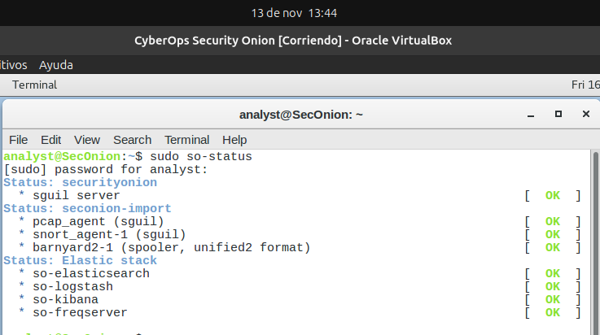

- Ajusto ventana de tiempo, del 2020/06/01 al 2020/06/30 :

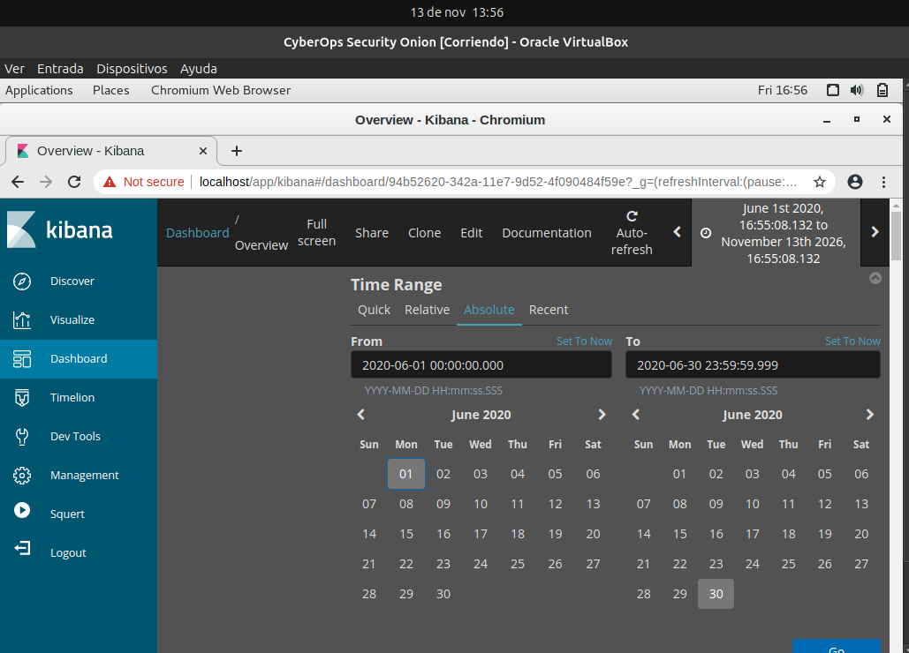

### Paso 2: Filtrar tráfico HTTP

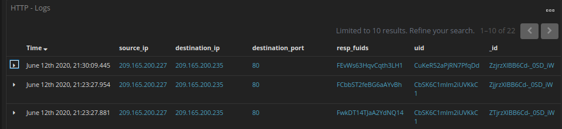

> ¿Cuál es la dirección IP de origen?

IP de origen: `209.165.200.227`

> ¿Cuál es la dirección IP de destino?

IP de destino: `209.165.200.235`

> ¿Cuál es el número de puerto de destino?

Puerto de destino: `80`

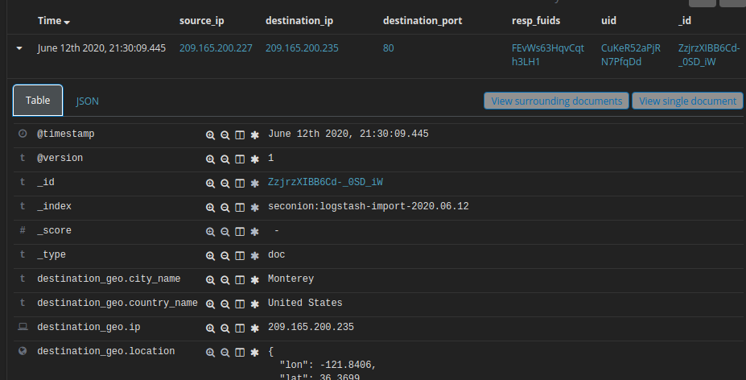

> ¿Cuál es la marca de tiempo del primer resultado?

timestamp: `June 12th 2020, 21:30:09.445`

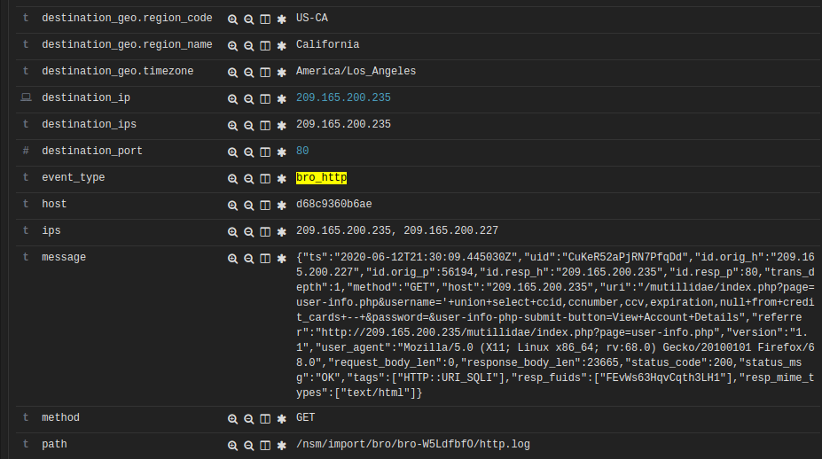

> ¿Cuál es el tipo de evento?

event_type: `bro_http`

> ¿Qué se incluye en el campo de mensaje? Estos son detalles sobre la solicitud HTTP GET que realizó el cliente al servidor. Enfocado especialmente en el uri field en el mensaje de texto.

El campo `message` contiene el registro de la solicitud HTTP GET enviada al servidor.
En el campo uri se puede ver el path y los parámetros.

> ¿Qué es importante sobre esta información?

Es importante porque demuestra un ataque exitoso de Inyección SQL hacia la página Mutillidae. 
En el parámetro username de la URL, hay una consulta SQL para extraer información sobre números de tarjetas de crédito, códigos CVV, fechas de vencimiento, etc. 
Y el servidor respondió con la información, el status_code es 200 (OK) y el tamaño de respuesta (response_body_len) es de 23665 bytes.

### Paso 3: Revise los resultados

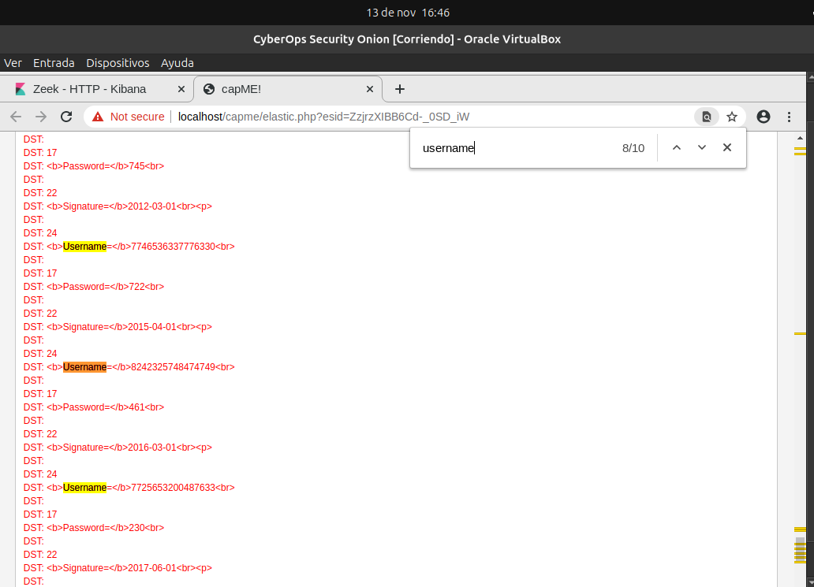

> ¿Qué puede ver más adelante en la transcripción en cuanto a nombres de usuario?

En lugar de nombres de usuario en el campo `username` se ven números de tarjetas de crédito, porque la consulta reemplazó las columnas de usuario, contraseña y firma de la página por los campos `ccnumber`, `ccv` y `expiration` de la tabla `credit_cards` de la base de datos.

> Dé algunos ejemplos de un nombre de usuario, contraseña y firma que se exfiltró.

- Username (ccnumber): `7746536337776330`,
  Password (CCV): `722`,
  Signature (expiration): `2015-04-01`

- Username (ccnumber): `8242325748474749`,
  Password (CCV): `461`,
  Signature (expiration): `2016-03-01`

- Username (ccnumber): `7725653200487633`,
  Password (CCV): `230`,
  Signature (expiration): `2017-06-01`

---

## Parte 2: Investigar la exfiltración de datos DNS

### Paso 1: Filtro para tráfico DNS

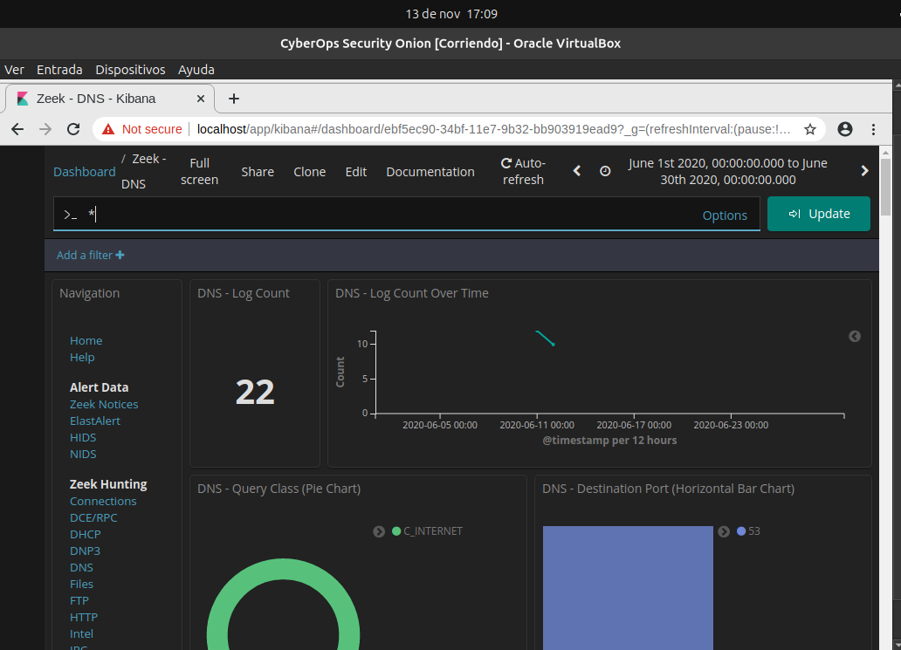

### Paso 2: Revise las entradas relacionadas con DNS.

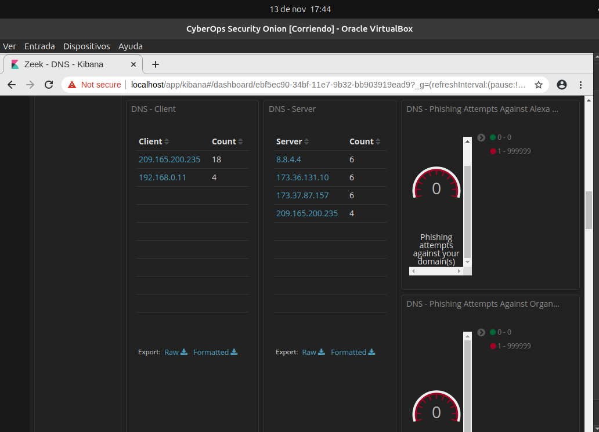

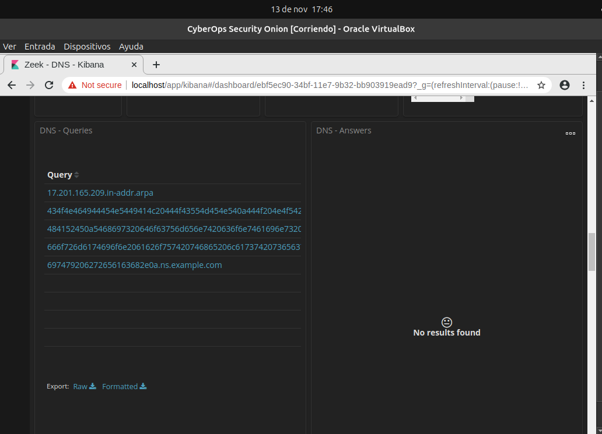

> Registre las direcciones IP del cliente y servidor DNS

Filtrando con `ns.example.com`

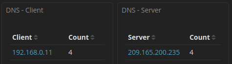

### Paso 3: Determine los datos exfiltrados.

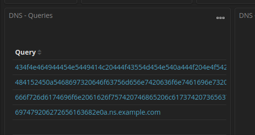

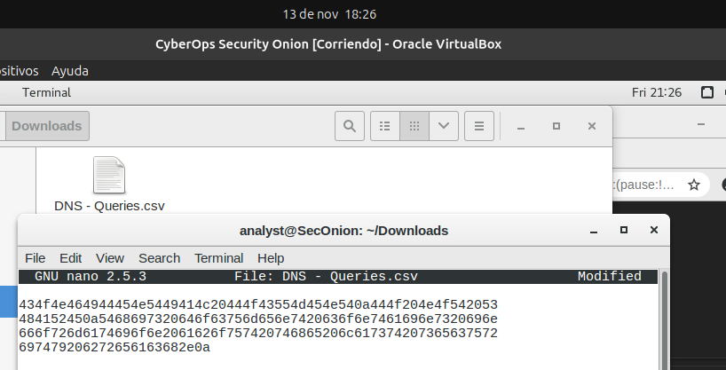

> ¿Fueron los subdominios de los subdominios de consulta DNS?

No, no son nombres de subdominios reales. Eran cadenas de texto codificadas en hexadecimal ocultas dentro del nombre de dominio (`ns.example.com`).

>  ¿Cuál es el texto?

El texto es: *CONFIDENTIAL DOCUMENT DO NOT SHARE This document contains information about the last security breach.*

> > DOCUMENTO CONFIDENCIAL NO COMPARTIR. Este documento contiene información sobre la última brecha de seguridad.

> ¿Qué implica este resultado sobre esta respuesta DNS en particular? 

Las consultas DNS no tenían como objetivo resolver una dirección IP real, sino transportar datos robados desde el equipo interno hacia el servidor controlado por el atacante (`ns.example.com`).

> ¿Cuál es el mayor significado?

Confirma que ocurrió una exfiltración de datos exitosa (mediante DNS Tunneling). Un actor de amenazas comprometió un equipo de la red, accedió a un archivo confidencial y logró extraer su contenido hacia el exterior sin ser bloqueado.

> ¿Qué puede haber creado estas consultas DNS codificadas?

Las puede haber creado un troyano, ejecutado por el atacante en el host comprometido, leyendo un archivo local, fragmentandolo, convirtiendolo a hexadecimal y lo envia como prefijos de consultas DNS.

> ¿Por qué se seleccionó DNS como los medios para exfiltrar datos?

Porque es un protocolo fundamental para el funcionamiento de Internet que casi siempre está permitido a través de los firewalls, permitiendo enviar datos y pasar desapercibido como tráfico normal de red.
