# Investigación de un ataque en un host de Windows

## Parte 1: Investiga el ataque con Sguil

### Paso 1: Abra Sguil y localice las alertas en 3-19-2019

> Alertas del 19 de marzo de 2019 en Sguil:

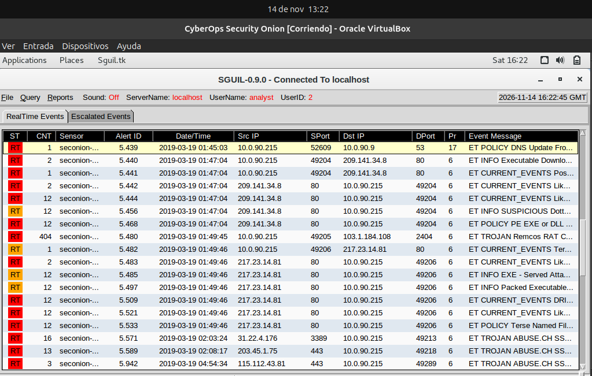

> Según Sguil, ¿cuáles son las marcas de tiempo para la primera y última de las alertas que ocurrieron el 3-19-2019? 

El 2019-03-19 la primera alerta fue a las `01:45:03` horas, y la última alerta fue a las `04:54:34` horas.

> ¿Qué es interesante acerca de las marcas de tiempo de todas las alertas del 3-19-2019?

Varias alertas se dispararon al mismo tiempo (mismo segundo), a las 01:47:04 y a las 01:49:46. 
En menos de 5 minutos se dispara la mayoría.

### Paso 2: Revise las alertas en detalle

> Primera alerta `5.439` `show packet data` y `show rule`:

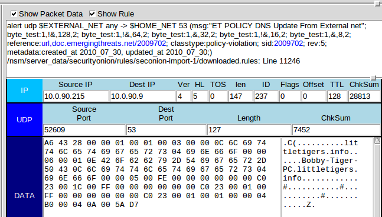

> En Wireshark:

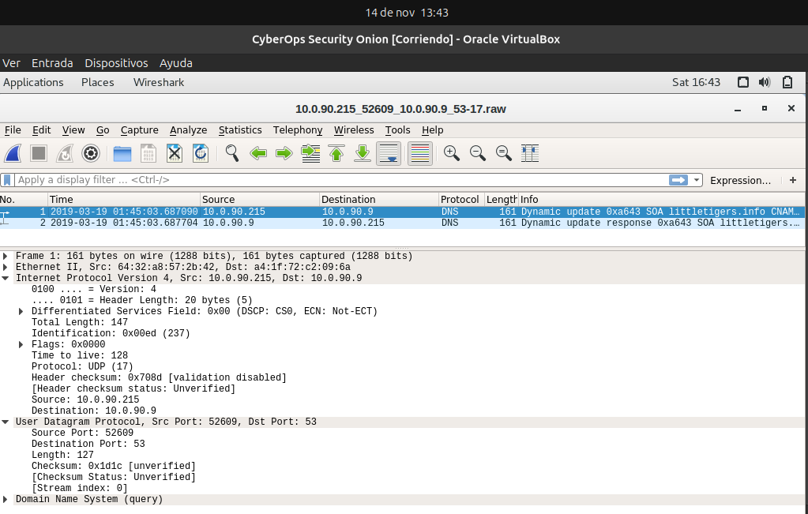

> ¿Cuál era la dirección IP de origen y el número de puerto y la dirección IP de destino y el número de puerto?

- IP de origen: `10.0.90.215`
- Puerto de origen: `52609`
- IP de destino: `10.0.90.9`
- Puerto de destino:`53`

> ¿Qué tipo de protocolo y solicitud o respuesta estuvo involucrado?

Tipo de Protocolo: UDP (17).

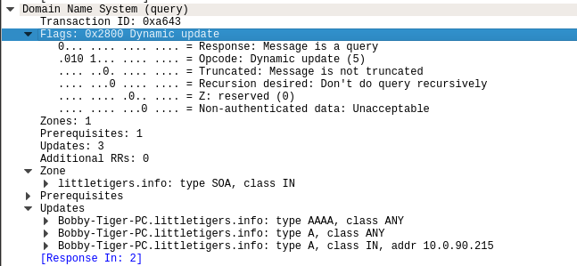

La solicitud es de actualización dinámica de DNS (`Opcode: Dynamic update`).

> ¿Qué es la alerta y el mensaje de IDS?

> IDS: Intrusion Detection System (Sistema de Detección de Intrusiones).

La regla de IDS está diseñada para detectar cuando un equipo externo intenta modificar registros en un servidor DNS interno.

La alerta indica que hay una violación de política de seguridad.

El mensaje de IDS fue: ET POLICY DNS Update From External net.

> ¿Cree que esta alerta fue el resultado de una mala configuración de IDS o de una comunicación sospechosa legítima?

Fue el resultado de una mala configuración de IDS (un falso positivo). La regla está configurada para alertar cuando una actualización dinámica de DNS proviene de una red externa (`$EXTERNAL_NET -> $HOME_NET`).
Y tanto el equipo de origen (10.0.90.215) como el servidor DNS de destino (10.0.90.9) pertenecen a la misma red interna (10.0.90.0/24), por lo tanto el tráfico está dentro de su dominio local.

> ¿Cuál es el nombre de host, el nombre de dominio y la dirección IP del host de origen en la actualización DNS?

> El hostname es la primera etiqueta antes del primer punto, y el nombre de dominio es todo lo que viene después del primer punto. Se ve en la captura de la query de DNS.

- Nombre de host: `Bobby-Tiger-PC`
- Nombre de dominio: `littletigers.info`
- IP del host de origen: `10.0.90.215`

> `Transcript` de la alerta `5.440`:

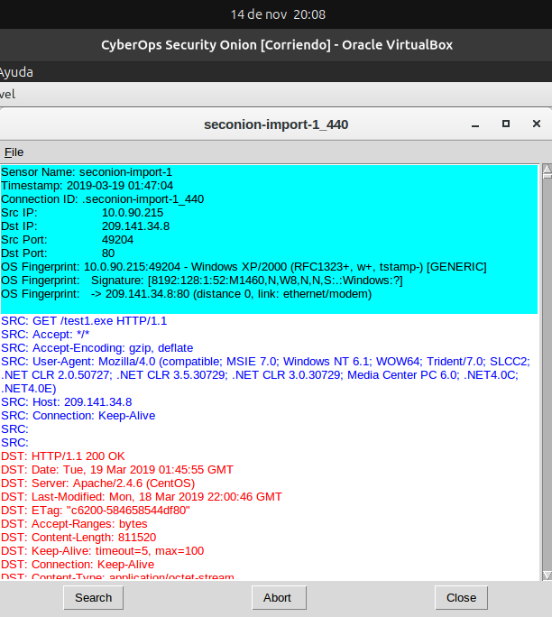

> ¿Cuáles son las direcciones MAC e IP y los números de puerto de origen y de destino?

En transcript no aparece la MAC, así que la busqué en wireshark:

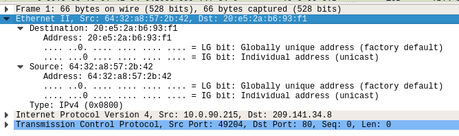

- MAC de origen: `64:32:a8:57:2b:42` 
- MAC de destino: `20:e5:2a:b6:93:f1`
- IP de origen: `10.0.90.215`
- Puerto de origen: `49204`
- IP de destino: `209.141.34.8`
- Puerto de destino: `80`

> Mirando la solicitud (azul) ¿para qué fue la solicitud?

Fue una solicitud HTTP `GET` para descargar el archivo ejecutable `/test1.exe` desde el servidor web.

> ¿Cuáles son los primeros caracteres del archivo? Busca esta firma de archivo para averiguar qué tipo de archivo se ha descargado en los datos

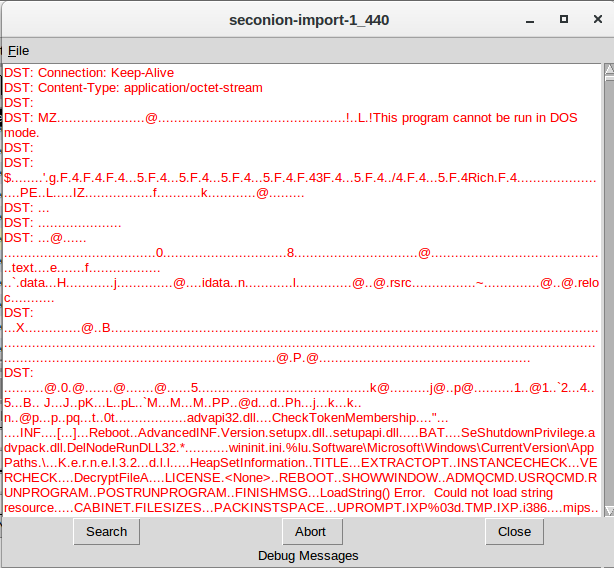

Los primeros caracteres del archivo son `MZ`.

La firma `MZ` corresponde a un archivo ejecutable de DOS/Windows (un archivo `.exe` o `.dll`).

- `sha256sum` en Talos File Reputation:

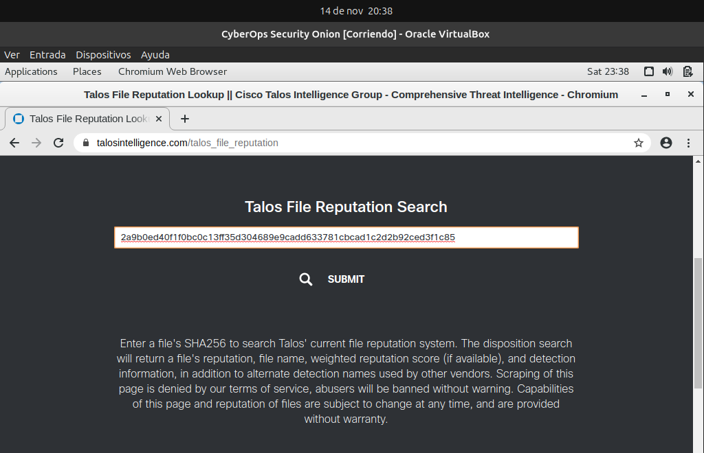

> ¿Reconoció Talos el hash del archivo y lo identificó como malware? Si es así, ¿qué tipo de malware?

Sí, Talos lo clasifica con reputación Malicious (malicioso), y el tipo de malware es un `Troyano` para Windows de 32 bits.

> Alerta `5.480` y `transcript`:

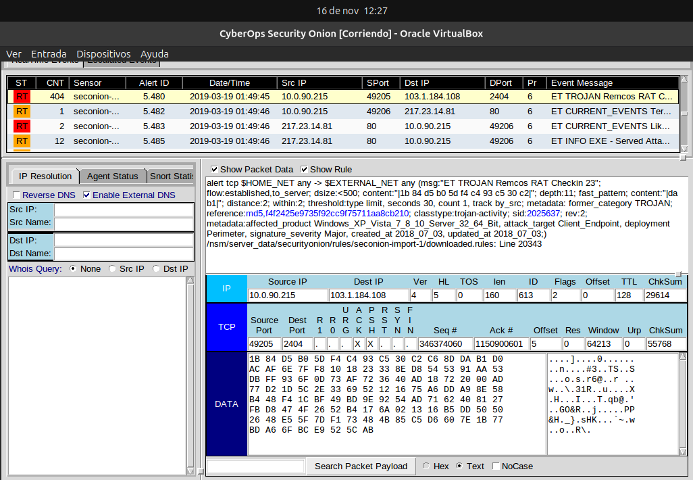

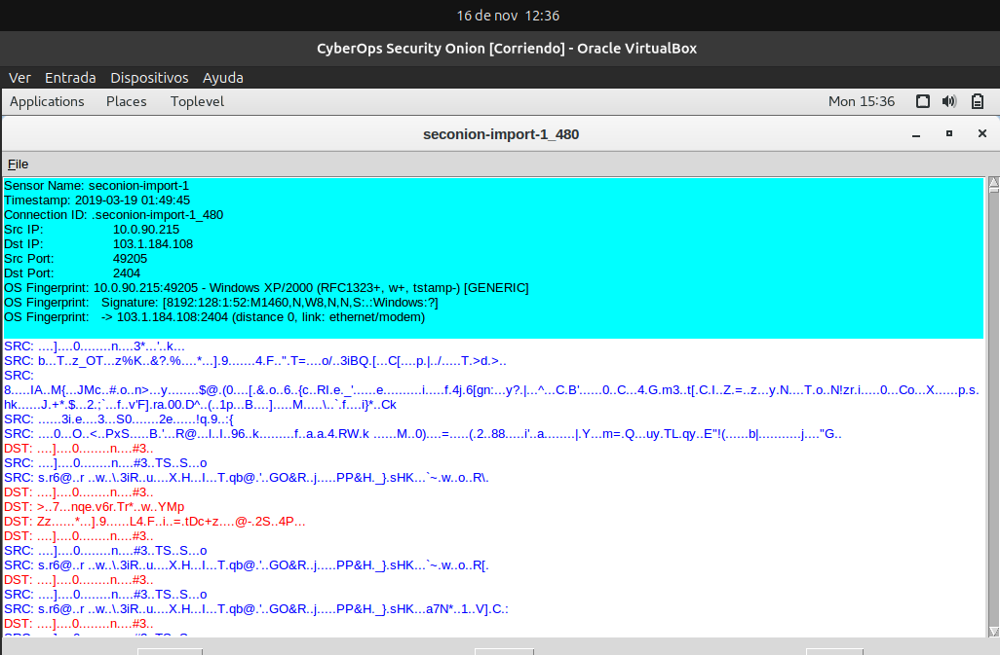

> ¿Cuál es el puerto de destino de la comunicación? 

Puerto de destino:`2404`.

> ¿Es este un puerto conocido?

No, no es un puerto conocido, los conocidos van del `0` al `1023`.

> ¿Es legible la comunicación o está encriptada?

No es legible, está encriptada. En la captura de transcript se ve que tanto los datos enviados por el host (`SRC:` en azul) como las respuestas del servidor (`DST:` en rojo) muestran bytes aleatorios y caracteres sin sentido.

> Haga algunas investigaciones en línea sobre Remcos RAT Checkin 23. ¿Qué hace Remcos?

> Remcos: Remote Control & Surveillance.

Es un troyano de acceso remoto (RAT) comercializado originalmente como herramienta legítima de administración remota para Windows, pero utilizado por ciberdelincuentes para inyectar malware. 
Una vez instalado en el equipo víctima, permite al atacante tomar control total de forma remota.

> ¿Qué tipo de comunicación crees que se estaba transmitiendo?

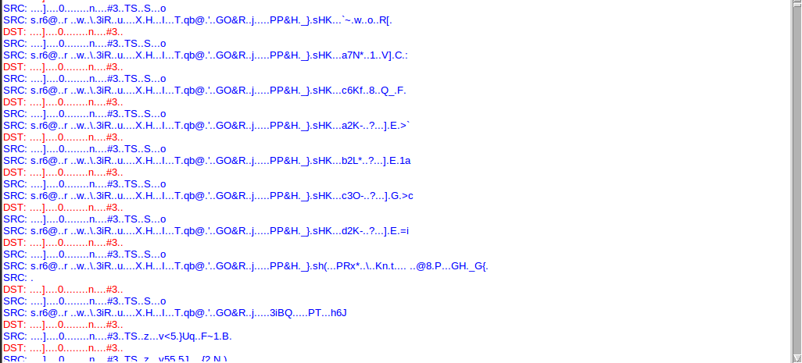

Se ve en la captura que entre `SRC` y `DST` se repiten los mismos bytes.
Parece tráfico de `comando y control`. 
El equipo infectado está enviando señales de latido (check-ins) al servidor del atacante.
Sirve para reportar información básica del sistema comprometido, confirmar que sigue activo y esperar órdenes.

> ¿Qué tipo de encriptación y ofuscación se usó para eludir la detección?

- Encriptación: Remcos cifra sus comunicaciones de red mediante el algoritmo de cifrado simétrico **RC4** utilizando una clave precompartida configurada al generar el binario del malware.

- Ofuscación: Utiliza empaquetado del ejecutable y la transmisión sobre un puerto no estándar con payloads binarios cifrados para evadir antivirus tradicionales e inspecciones de tráfico HTTP/HTTPS.

---

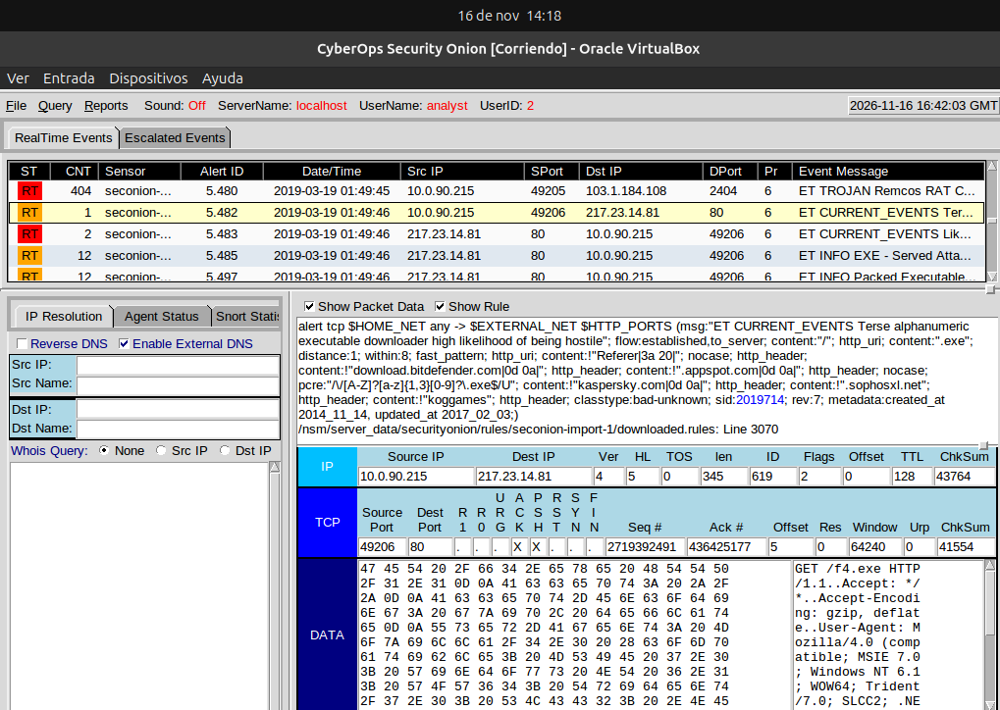

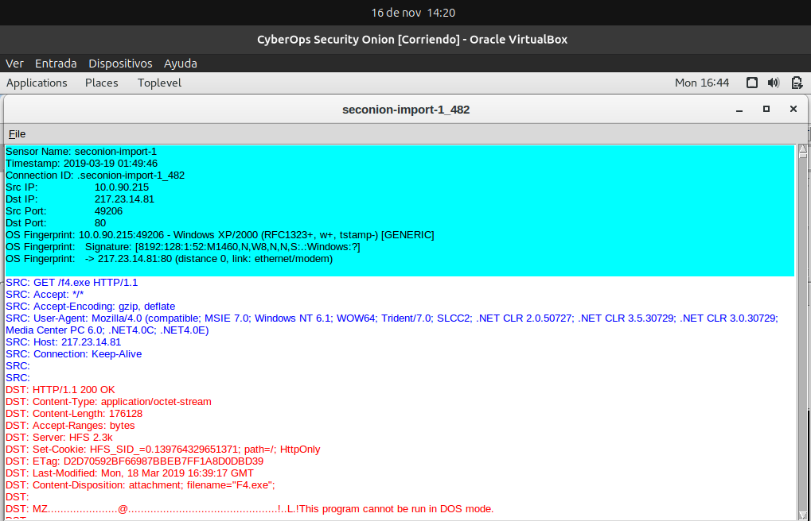

> ¿Qué ID alerta a un segundo archivo ejecutable que se está descargando?

El segundo archivo ejecutable descargado se da en la alerta `5482`, donde inicia la segunda secuencia de alertas al mismo tiempo.

> ¿Desde qué dirección IP del servidor y número de puerto se descargó el archivo?

- IP del servidor: `217.23.14.81`   
- Puerto: `80`  

> ¿Cuál es el nombre del archivo que se ha descargado?

- `f4.exe`

> Cree un hash SHA256 del archivo y envíe el hash en línea en el Centro de Reputación de Archivos de Talos de Cisco para ver si coincide con el malware conocido. 

- Descargo desde Wireshark el archivo `f4.exe`:

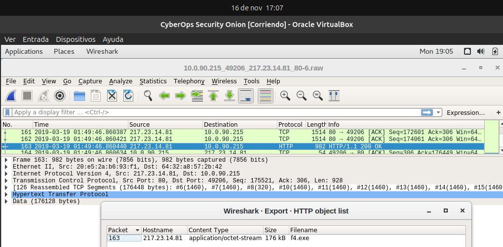

- Resultado en Talos:

> ¿Es el archivo ejecutable malware conocido y, en caso afirmativo, de qué tipo?

Sí, Talos lo clasifica como Malicious.
Es un Troyano para Windows de 32 bits. 

>  ¿Cuál es el nombre de la detección de AMP?

> AMP: Advanced Malware Protection (Protección Avanzada contra Malware).
> Cisco la renombró como `Cisco Secure Endpoint`

El nombre de la detección de AMP es: `Win.Dropper.Cridex::1201`

> Tres alertas restantes del 3-19-2019, `5571`, `5589`, `5942`:

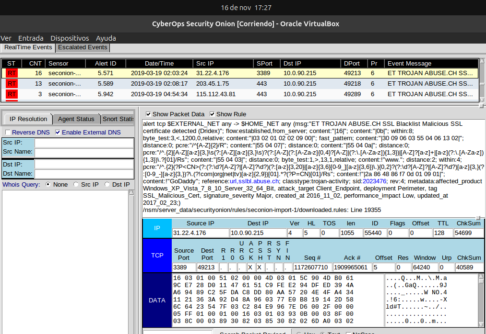

> ¿Cómo se relacionan las tres alertas?

Las tres alertas disparan exactamente la misma regla de IDS `ET TROJAN ABUSE.CH SSL Blacklist Malicious SSL certificate detected (Dridex)`.

Representan las comunicaciones de Comando y Control (C2) del segundo malware descargado desde el equipo comprometido (`10.0.90.215`) hacia tres servidores externos distintos utilizando tráfico cifrado SSL/TLS.

> Otra cosa que me llamo la atención es la condición `content:!"GoDaddy"` que figura en las 3.
> Ese parámetro actúa como una regla de exclusión para evitar falsos positivos sobre certificados legítimos emitidos por la autoridad certificadora "GoDaddy", asegurando que la alerta se dispare únicamente ante certificados maliciosos o autofirmados asociados al troyano Dridex

---

## Parte 2: Usar Kibana para investigar alertas

### Paso 1: Abre Kibana y reduce el plazo

> Kibana evento del 19 de marzo:

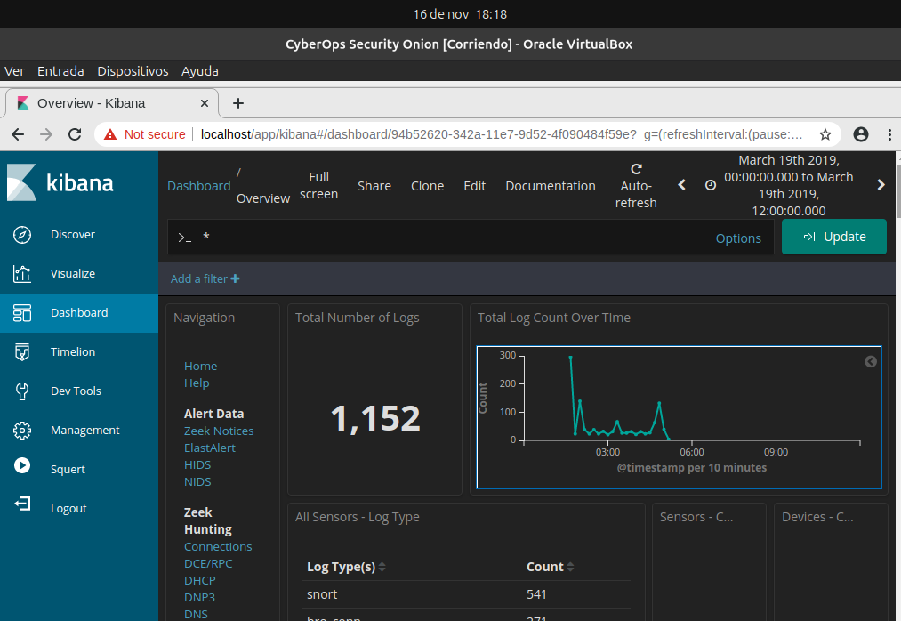

### Paso 2: Revise las alertas en el marco de tiempo reducido

> Kibana `NIDS` y `All Logs`:

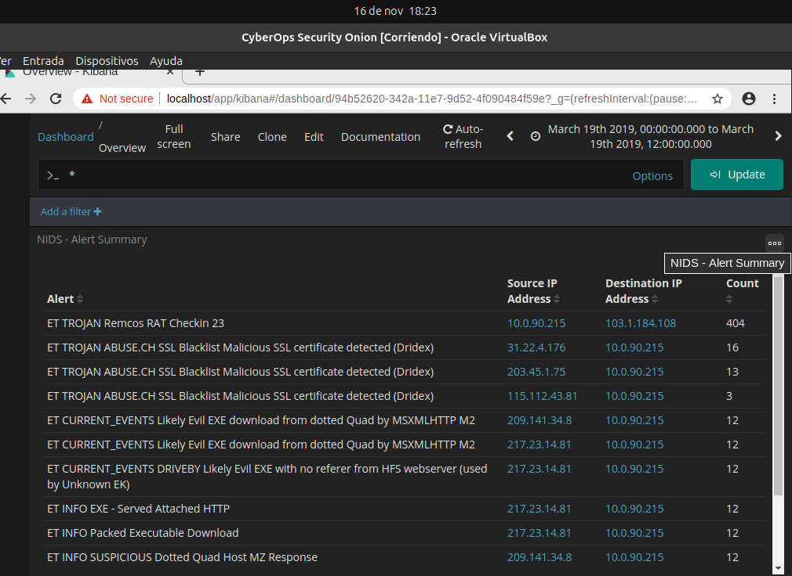

> ¿Cuál es el geopaís y la ubicación de la ciudad para esta alerta?

El país es Reino Unido, y la ciudad Newcastle.

> ¿Cuál es el país y la ciudad geográficos para la alerta de 115.112.43.81?

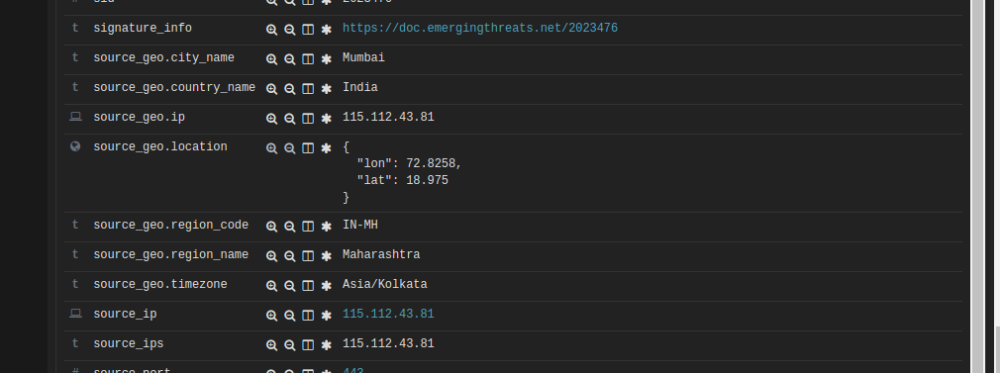

El país es India, y la ciudad Mumbai.

> Panel HTTP:

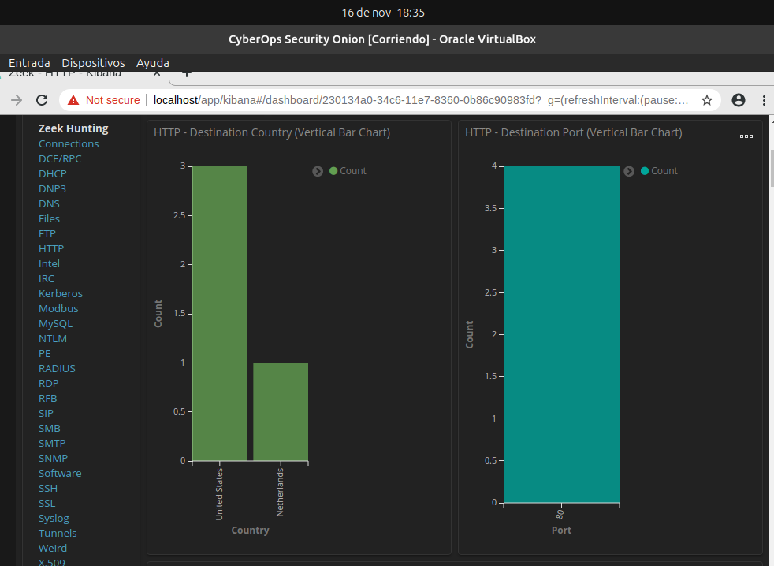

> ¿Qué es el recuento de registros en el panel HTTP?

El Recuento de registros HTTP es la cantidad total de solicitudes o transacciones HTTP individuales que Zeek registró en el archivo de logs. 

> ¿De qué países?

Estados Unidos y Países Bajos.

> ¿Cuáles son los URI de los archivos descargados?

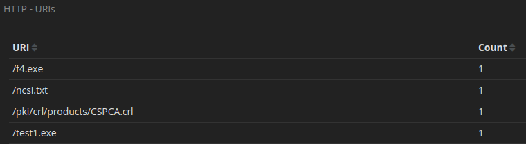

> ¿A qué están relacionados los archivos CSPCA.crl y ncsi.txt? Utilice un navegador web y un motor de búsqueda para obtener información adicional.

Ambos archivos corresponden a tráfico legítimo del sistema operativo Microsoft Windows.

> `ncsi.txt` (Network Connectivity Status Indicator).

- Es un archivo de texto plano alojado por Microsoft que Windows descarga automáticamente cada vez que se conecta a una red para comprobar si tiene acceso real a Internet o si está detrás de un portal cautivo.

> `CSPCA.crl` (Certificate Revocation List).

- Es una lista de Revocación de Certificados emitida por una Autoridad Certificadora de Microsoft (`Microsoft-CryptoAPI`) dentro de su infraestructura de clave pública. Windows descarga este archivo `.crl` periódicamente para verificar si algún certificado digital SSL/TLS ha sido revocado o caducado antes de confiar en él.

> Panel DNS:

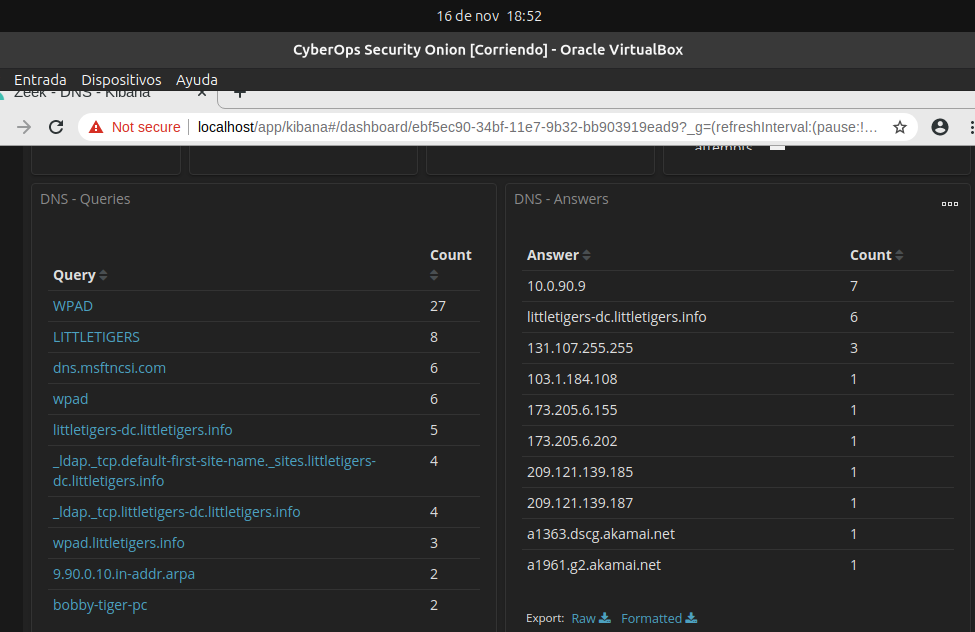

> ¿Alguno de los dominios parece potencialmente inseguro? 

Sí, por su patrón de nombre repetitivo con extensión `.online`, `toptoptop1.online` parece potencialmente inseguro.

> Intente enviar la URL toptoptop1.online a virustotal.com. ¿Cuál es el resultado?

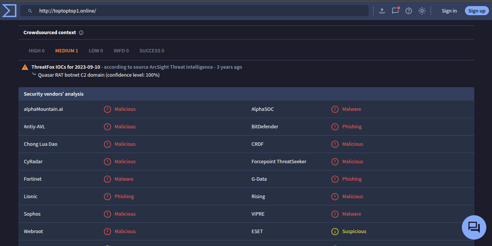

Resultado en VirusTotal: Múltiples proveedores de seguridad (como alphaMountain.ai, Webroot, AlphaSOC, etc) lo marcan como sitio malicioso, de malware o phishing.
