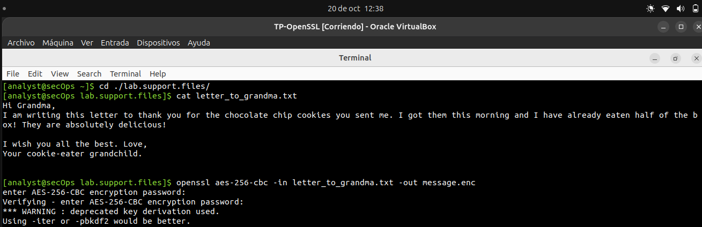
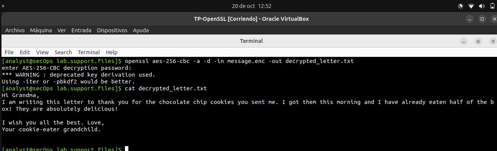
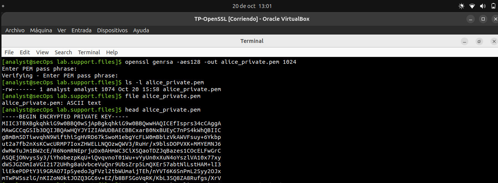
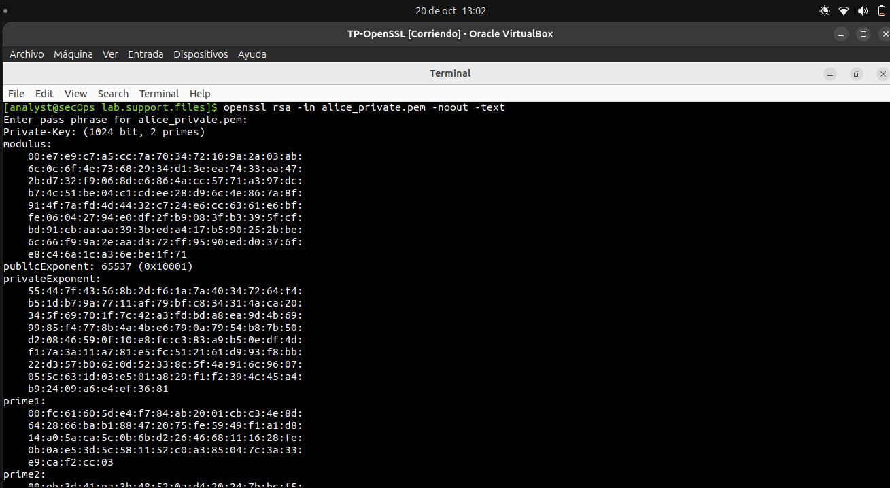
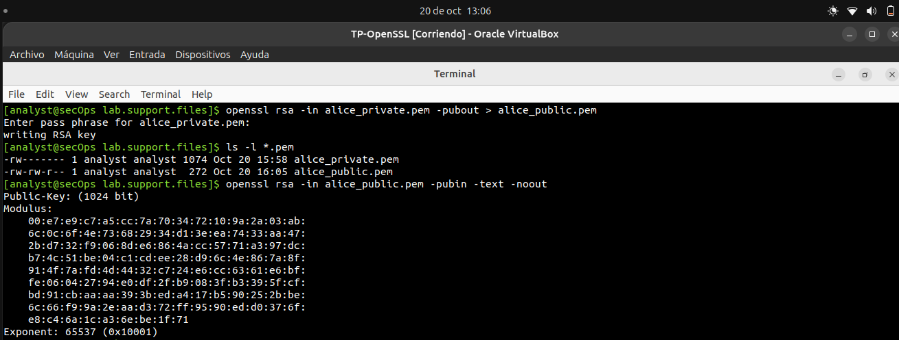
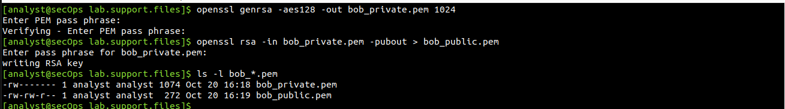
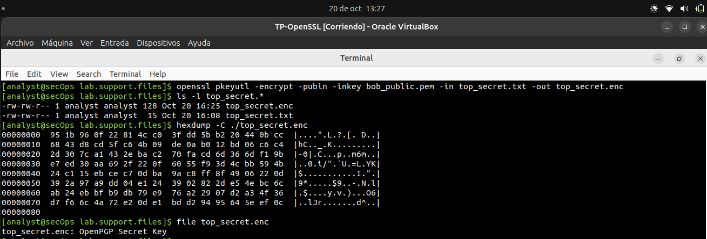
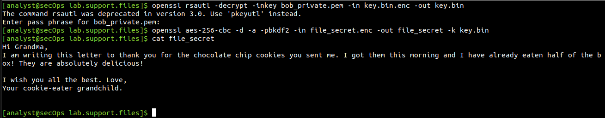

# OpenSSL

## Cifrar mensajes con OpenSSL utilizando criptografía simétrica

### Cifrar un archivo de texto

```bash
cd ./lab.support.files/
cat letter_to_grandma.txt
openssl aes-256-cbc -in letter_to_grandma.txt -out message.enc
```


### Cifrado AES-256-CBC sin Base64 y con Base64 (-a) 

```bash
cat message.enc
openssl aes-256-cbc -a -in letter_to_grandma.txt -out message.enc
cat message.enc
```


## Descifrar mensajes con OpenSSL utilizando criptografía simétrica

```bash
openssl aes-256-cbc -a -d -in message.enc -out decrypted_letter.txt
cat decrypted_letter.txt
```


## Cifrar y descifrar datos con OpenSSL utilizando criptografía asimétrica

### Cifrar mensajes con OpenSSL utilizando criptografía asimétrica

```bash
openssl genrsa -aes128 -out alice_private.pem 1024
ls -l alice_private.pem
file alice_private.pem
head alice_private.pem
openssl rsa -in alice_private.pem -noout -text
```




### Extraer la clave pública

```bash
openssl rsa -in alice_private.pem -pubout > alice_public.pem
ls -l *.pem
openssl rsa -in alice_public.pem -pubin -text -noout
```


### Intercambiar mensajes encriptados con la clave públicas

```bash
echo "vim or emacs ?" > top_secret.txt
cat top_secret.txt
```


> Hago el mismo procedimiento de Alice para Bob.
```bash
openssl genrsa -aes128 -out bob_private.pem 1024
openssl rsa -in bob_private.pem -pubout > bob_public.pem
ls -l bob_*.pem
```


```bash
openssl pkeyutl -encrypt -pubin -inkey bob_public.pem -in top_secret.txt -out top_secret.enc
ls -l top_secret.*
hexdump -C ./top_secret.enc
file top_secret.enc
```


## Descifrar mensajes con OpenSSL utilizando criptografía asimétrica

### Desencriptar mensaje cifrado utilizando la clave privada

```bash
openssl rsautl -decrypt -inkey bob_private.pem -in top_secret.enc > top_secret.txt
cat top_secret.txt
```


## Cifrar y descifrar grandes archivos con OpenSSL

### Genero una clave random y encripto con la clave publica de Bob

> Como no existe un archivo file_secret use letter_to_grandma.txt

```bash
cp letter_to_grandma.txt file_secret
openssl rand -base64 32 > key.bin
openssl rsautl -encrypt -pubin -inkey bob_public.pem -in key.bin -out key.bin.enc
openssl aes-256-cbc -a -pbkdf2 -salt -in file_secret -out file_secret.enc -k key.bin

```


### Desencripto file_secret con la clave privada de Bob

```bash
openssl rsautl -decrypt -inkey bob_private.pem -in key.bin.enc -out key.bin
openssl aes-256-cbc -d -a -pbkdf2 -in file_secret.enc -out file_secret -k key.bin
```


---
