# OpenSSL

## Cifrar mensajes con OpenSSL utilizando criptografía simétrica

### Cifrar un archivo de texto

```bash
cd ./lab.support.files/
cat letter_to_grandma.txt
openssl aes-256-cbc -in letter_to_grandma.txt -out message.enc
```
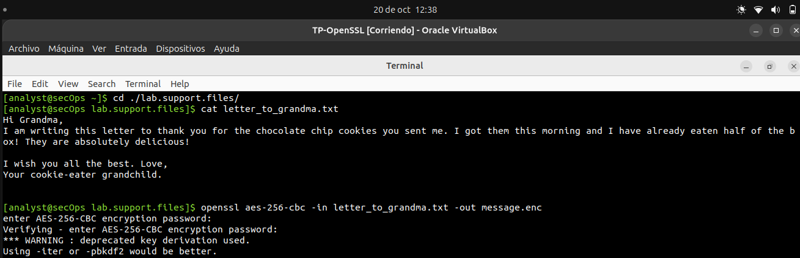

### Cifrado AES-256-CBC sin Base64 y con Base64 (-a) 

```bash
cat message.enc
openssl aes-256-cbc -a -in letter_to_grandma.txt -out message.enc
cat message.enc
```


## Descifrar mensajes con OpenSSL utilizando criptografía simétrica

```bash
openssl aes-256-cbc -a -d -in message.enc -out decrypted_letter.txt
cat decrypted_letter.txt
```
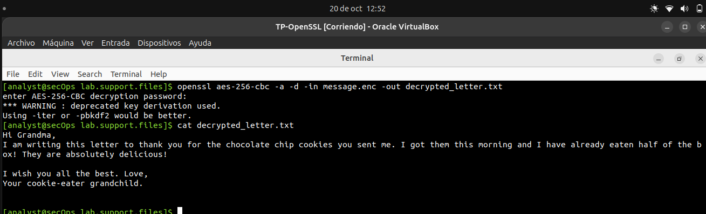

## Cifrar y descifrar datos con OpenSSL utilizando criptografía asimétrica

### Cifrar mensajes con OpenSSL utilizando criptografía asimétrica

```bash
openssl genrsa -aes128 -out alice_private.pem 1024
ls -l alice_private.pem
file alice_private.pem
head alice_private.pem
openssl rsa -in alice_private.pem -noout -text
```
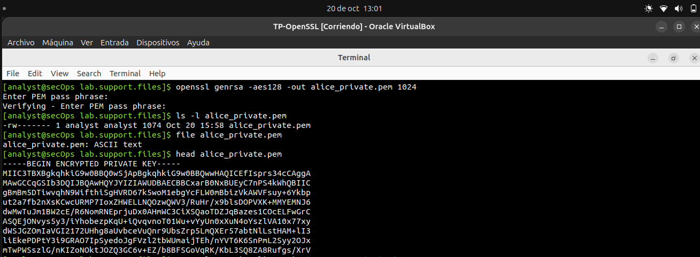

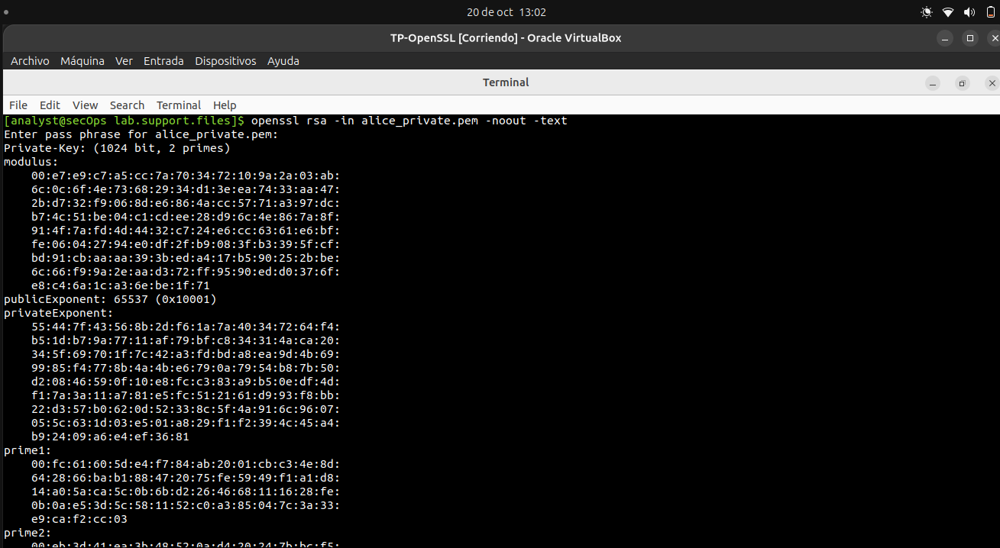

### Extraer la clave pública

```bash
openssl rsa -in alice_private.pem -pubout > alice_public.pem
ls -l *.pem
openssl rsa -in alice_public.pem -pubin -text -noout
```
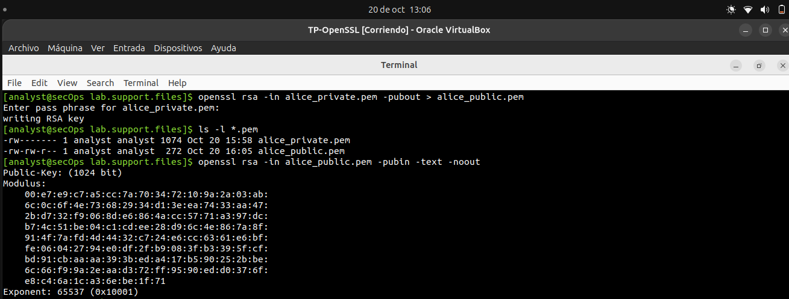

### Intercambiar mensajes encriptados con la clave públicas

```bash
echo "vim or emacs ?" > top_secret.txt
cat top_secret.txt
```
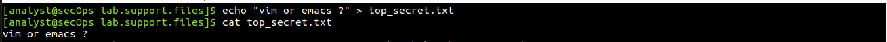

> Hago el mismo procedimiento de Alice para Bob.
```bash
openssl genrsa -aes128 -out bob_private.pem 1024
openssl rsa -in bob_private.pem -pubout > bob_public.pem
ls -l bob_*.pem
```
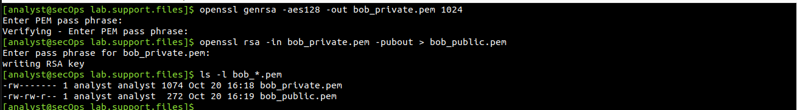

```bash
openssl pkeyutl -encrypt -pubin -inkey bob_public.pem -in top_secret.txt -out top_secret.enc
ls -l top_secret.*
hexdump -C ./top_secret.enc
file top_secret.enc
```
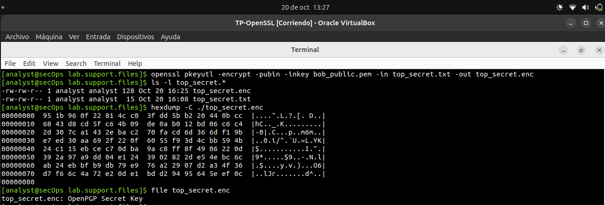

## Descifrar mensajes con OpenSSL utilizando criptografía asimétrica

### Desencriptar mensaje cifrado utilizando la clave privada

```bash
openssl rsautl -decrypt -inkey bob_private.pem -in top_secret.enc > top_secret.txt
cat top_secret.txt
```
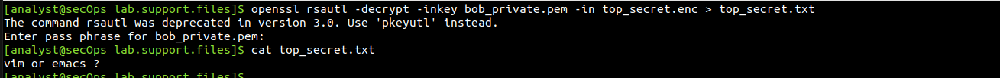

## Cifrar y descifrar grandes archivos con OpenSSL

### Genero una clave random y encripto con la clave publica de Bob

> Como no existe un archivo file_secret use letter_to_grandma.txt

```bash
cp letter_to_grandma.txt file_secret
openssl rand -base64 32 > key.bin
openssl rsautl -encrypt -pubin -inkey bob_public.pem -in key.bin -out key.bin.enc
openssl aes-256-cbc -a -pbkdf2 -salt -in file_secret -out file_secret.enc -k key.bin

```
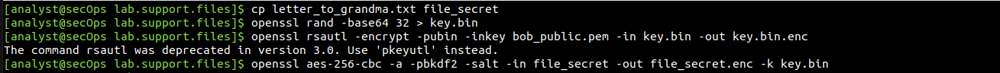

### Desencripto file_secret con la clave privada de Bob

```bash
openssl rsautl -decrypt -inkey bob_private.pem -in key.bin.enc -out key.bin
openssl aes-256-cbc -d -a -pbkdf2 -in file_secret.enc -out file_secret -k key.bin
```
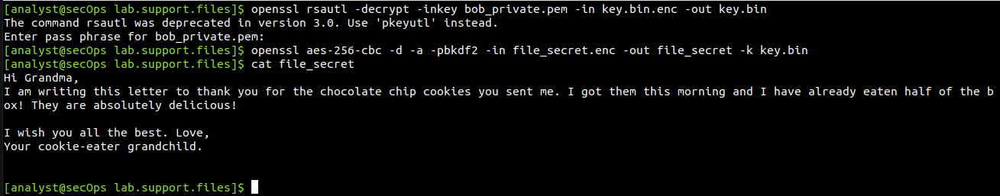

---
---

# Criptografía y Certificados Digitales en la Práctica

## PARTE 1: Fundamentos Teóricos (PKI y Estándar X.509)

### Definición básica 

> ¿Qué es exactamente un certificado digital X.509? 

* **Certificado Digital X.509:** Es un documento digital estandarizado bajo la norma ITU-T X.509 que vincula criptográficamente una clave pública con la identidad de una entidad (un dominio web, persona u organización) mediante la firma digital de una Autoridad de Certificación (CA) de confianza.

> ¿y qué problema fundamental de criptografía asimétrica resuelve?

* **Problema que resuelve:** La criptografía asimétrica por sí sola no garantiza la identidad del dueño de una clave pública. El certificado X.509 resuelve este problema introduciendo la CA que certifica que la clave pública le pertenece realmente al dominio solicitante, evitando que un intermediario pueda suplantar la identidad en el canal cifrado.

---

### El Rol de la CA 

> ¿Qué es una Autoridad de Certificación (CA)? 

Es una entidad de confianza (pública o privada) encargada de verificar la identidad de quienes solicitan certificados, emitir dichos certificados digitales firmándolos con su propia clave privada.

> ¿y por qué los navegadores confían en ellas para validar la identidad de un sitio web?

Los navegadores vienen preconfigurados con un "Almacén de Confianza" (*Trust Store*) que contiene una lista predeterminada de Certificados Raíz de CAs auditadas bajo estándares de seguridad. Si la CA valida la identidad del sitio y firma su certificado, el navegador confía en el sitio porque confía implícitamente en esa CA.

---

### Jerarquía

> Define las diferencias y responsabilidades entre un Certificado Raíz (Root CA), un Certificado Intermedio y un Certificado de Entidad Final (End-Entity/Leaf Certificate).

* **Certificado Raíz:** Es el certificado ubicado en la cima de la jerarquía. Está autofirmado (*self-signed*) y su clave privada se almacena bajo extremas medidas de seguridad (por lo general offline en instalaciones físicas ultraseguras). Su clave pública reside en los almacenes de confianza de los sistemas operativos/navegadores.

* **Certificado Intermedio:** Es un certificado emitido y firmado por la CA Raíz (o por otro intermedio) cuya función principal es actuar como puente y firmar los certificados de los clientes/sitios web finales. Protege a la CA Raíz de estar expuesta directamente a la red en las operaciones diarias.

* **Certificado de Entidad Final:** Es el certificado expedido para el dominio o servidor web específico.

---

### Ciclo de vida 

> ¿Qué es una Lista de Revocación de Certificados (CRL) y qué es OCSP? 

* **CRL (Certificate Revocation List):** Es una lista publicada periódicamente por la CA que contiene los números de serie de los certificados que han sido revocados antes de su fecha de caducidad.

* **OCSP (Online Certificate Status Protocol):** Es un protocolo de red que permite a los clientes/navegadores consultar en tiempo real el estado actual de un certificado específico ante la CA mediante un endpoint.

> ¿Por qué son necesarios incluso antes de que un certificado expire?

Un certificado puede perder su validez antes del tiempo estipulado por diversas razones: filtración o robo de la clave privada del servidor, cambio de propietario del dominio, la quiebra/cierre de la empresa o emisión fraudulenta. 
CRL y OCSP aseguran que un cliente no confíe en un certificado comprometido aunque todavía no haya vencido por fecha calendarizada.

-----------------------------------------------

## PARTE 2: Despliegue Práctico (Let's Encrypt)

> Primero: ¿Que es Let's Encrypt?

Let's Encrypt es una Autoridad de Certificación (CA) gratuita, automatizada y abierta, gestionada por el grupo de investigación de interés público Internet Security Research Group (ISRG).
Su objetivo principal es hacer que el cifrado en la Web (el protocolo HTTPS) sea accesible para todo el mundo, eliminando el costo económico y la complejidad técnica de obtener certificados SSL/TLS.

---

En VM instalo Nginx, inicio el servicio y verifico si funciona:
```bash
sudo apt install nginx -y
sudo systemctl start nginx
sudo systemctl status nginx
```


Para crear un dominio gratuito use "DuckDNS", https://www.duckdns.org/ .

Hice el login y genere un dominio:

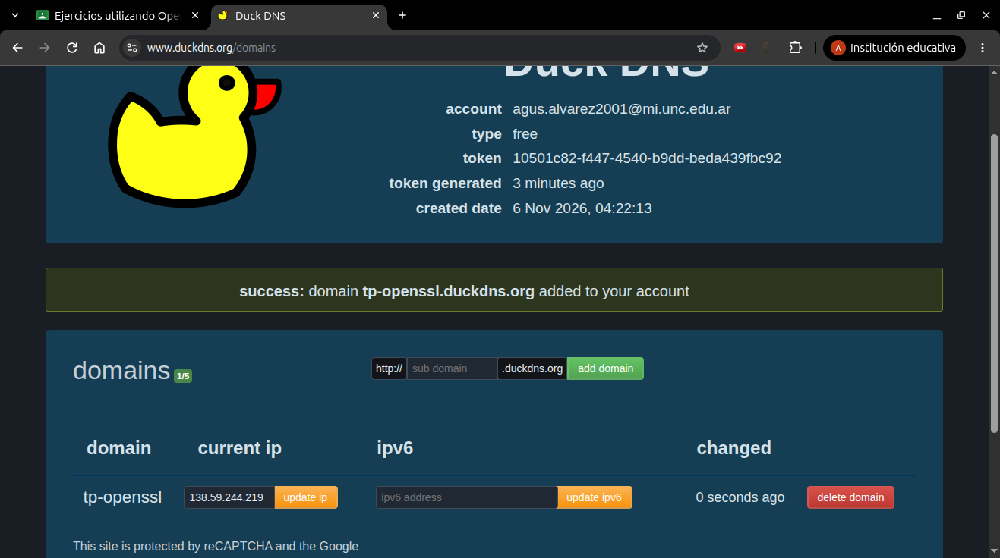

Para asociar el dominio dentro de Nginx creo un archivo de configuración con mi dominio, y la activo:

```bash
sudo nano /etc/nginx/sites-available/duckdns.conf
```
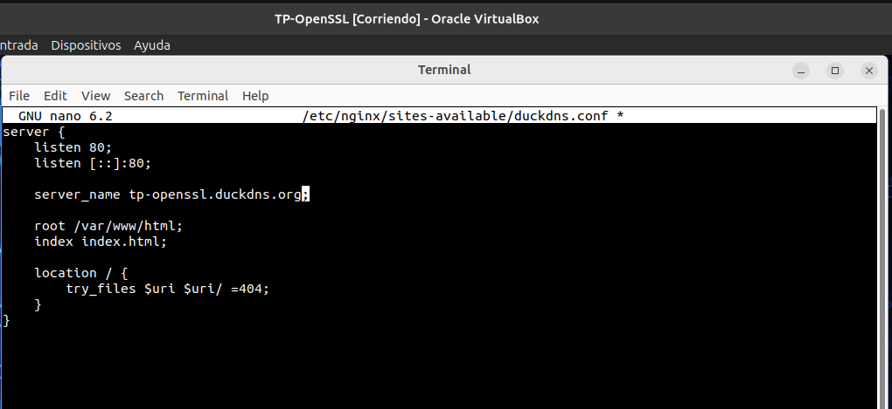

```bash
sudo ln -s /etc/nginx/sites-available/duckdns.conf /etc/nginx/sites-enabled/
sudo systemctl reload nginx
```

Para solicitar un certificado a Let's Encrypt instalo Certbot, el plugin de Certbot para DuckDNS y solicito el certificado usando DNS-01:

```bash
sudo apt install certbot python3-certbot-nginx -y
sudo apt install python3-pip -y
sudo pip3 install certbot-dns-duckdns
sudo certbot certonly \
  --authenticator dns-duckdns \
  --dns-duckdns-token 10501c82-f447-4540-b9dd-beda439fbc92 \
  --dns-duckdns-propagation-seconds 60 \
  -d tp-openssl.duckdns.org
```
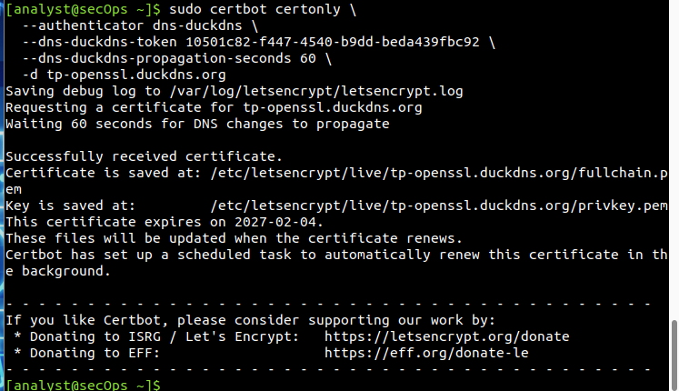

Vinculo el certificado generado a Nginx:
```bash
sudo nano /etc/nginx/sites-available/duckdns.conf
```
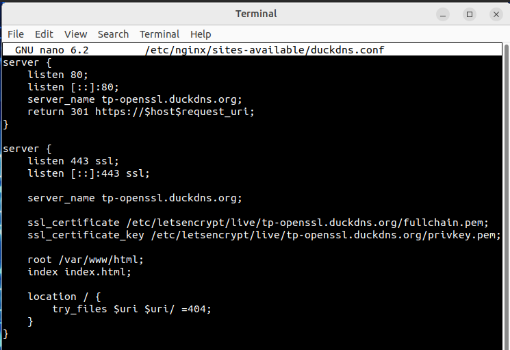

Recargo y pruebo la renovación automática:
```bash
sudo systemctl reload nginx
sudo certbot renew --dry-run
```
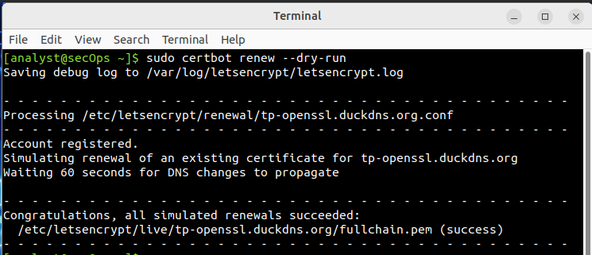

---

### Mecanismo de validación

> ¿Qué método de validación o "desafío" (challenge) utilizaste (ej. HTTP-01 o DNS-01) y cómo demostró este proceso a la CA que tú tienes el control real sobre ese dominio?

Se utilizó el desafío DNS-01, mediante el plugin certbot-dns-duckdns y la API de DuckDNS.

Al ejecutar Certbot, este interactúa con Let's Encrypt mediante el protocolo ACME para solicitar un certificado para mi dominio `tp-openssl.duckdns.org`.
La Autoridad de Certificación (CA) le entrega a Certbot un token criptográfico único. 
A través de la API de DuckDNS y usando el token de autenticación del usuario, Certbot crea automáticamente un registro DNS de tipo TXT en los servidores de nombres de DuckDNS.
Let's Encrypt realiza consultas DNS públicas a nivel global buscando ese registro TXT en el subdominio.
Al comprobar que el registro TXT existe en el DNS y que su contenido coincide con la firma solicitada, Let's Encrypt verifica la propiedad y el control administrativo del dominio. Con esto aprueba la emisión del certificado digital. 

### Duración de la confianza

> ¿cuáles son las dos principales ventajas de tener una vida útil tan corta?

Reduce el impacto si una clave privada se filtra o se compromete, si un atacante logra robar la clave privada o el certificado de tu servidor, solo podrá usarlo durante un tiempo muy corto.
Y fuerza la automatización, al vencer cada 3 meses, es tedioso renovar los certificados a mano, esto obliga a configurar sistemas de renovación automática (como Certbot). Si mañana se descubre una falla crítica de seguridad y la CA necesita revocar y cambiar todos los certificados, tu servidor ya estará preparado para renovarse automáticamente.

### Automatización

> ¿Por qué la automatización (ej. un cron job de Certbot) es un requisito casi obligatorio bajo el modelo de Let's Encrypt?

La automatización es un requisito casi obligatorio porque la carga manual es mucha y el riesgo de olvido es alto.
Automatizar evita la caída de servicios y bloqueos de seguridad, si un certificado expira sin renovarse, los navegadores bloquean inmediatamente el acceso al sitio mostrando pantallas rojas de advertencia (*"Conexión no segura"*), interrumpiendo el servicio.

---

## PARTE 3: Análisis de la Cadena de Confianza y Criptografía

Para ver el certificado no pude acceder desde el dominio, pero si buscado la IP de la VM en mi host.

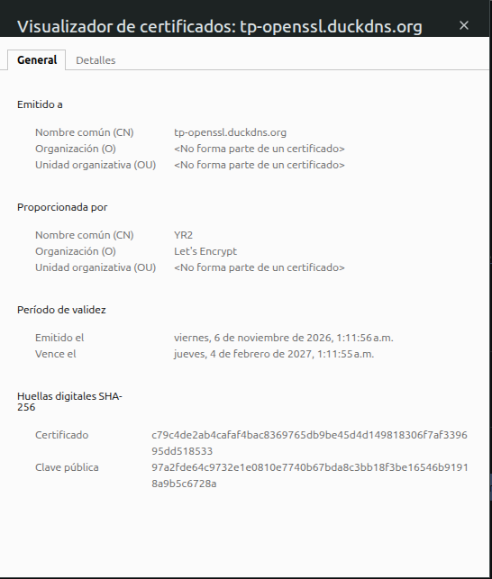

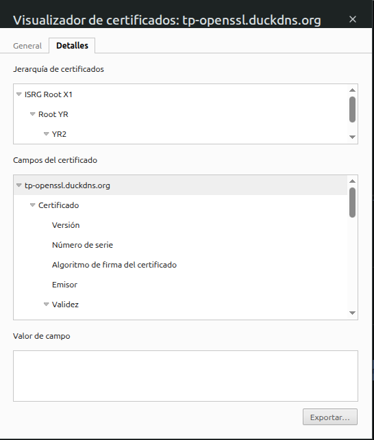

### Inspección de campos

> ¿Quién es el Issuer (Emisor) y quién es el Subject (Sujeto)?

`Let's Encrypt` es el emisor, y `tp-openssl.duckdns.org` el sujeto.

>​ ¿Qué algoritmo de clave asimétrica se está utilizando para la clave pública (ej. RSA, ECDSA) y de qué tamaño es la clave (ej. 2048 bits, secp256r1)?

Se está utilizando el algoritmo RSA y el tamaño de la clave es 2048 bits.

### Trazando la ruta (Chain of Trust)

> Escribe la cadena exacta de firmas desde tu certificado Leaf hasta el certificado Root en el que confía tu navegador (ej. ISRG Root X1).

ISRG Root X1 (CA Raíz) --> Root YR --> YR2 --> tp-openssl.duckdns.org (Certificado final / Leaf)

### Seguridad del ecosistema (Claves Raíz Offline)

> ¿Por qué el certificado de tu sitio web fue firmado por una CA Intermedia (ej. Let's Encrypt R3) y no directamente por la clave privada de la CA Raíz?

Es una forma de protección para la CA Raíz, al ser firmado por una CA intermedia se aisla la CA Raíz, incluso la clave privada se mantiene fuera de línea (offline), almacenada en hardware de máxima seguridad en instalaciones físicas protegidas. Solo se enciende de forma excepcional para firmar certificados de CAs Intermedias.
Las CAs Intermedias operan online para gestionar las firmas diarias. Si una CA Intermedia se compromete, puede ser revocada por la CA Raíz sin afectar el funcionamiento general.

### Validación matemática de la Firma Digital

> ¿Cómo utiliza la clave pública de la CA Intermedia para verificar la "Firma Digital" (Signature) de tu certificado y asegurar que no ha sido alterado?

La CA Intermedia genera la firma digital cifrando el resumen (hash) del certificado con su propia clave privada. Para comprobarlo, el navegador toma esa firma digital y la desencripta utilizando la clave pública de la CA Intermedia (que obtiene del certificado emisor). De este modo, se extrae el hash original calculado por la CA. 

Luego, el navegador calcula su propio hash (usando el mismo algoritmo) sobre todos los campos del certificado recibido (el nombre de dominio, la clave pública del sitio, las fechas de validez, etc), y compara los dos valores, el hash desencriptado (extraído de la firma) y el hash calculado (generado localmente).   

Ambos hash deben ser iguales, garantizando Integridad (si se modificó algo los hash's serian distintos) y Autenticidad del origen (el hash original solo pudo haber sido cifrado con la clave privada de la CA Intermedia y la clave pública de la CA es la única capaz de desencriptarlo).

### Almacén de confianza (Trust Store)

> ¿De dónde saca tu sistema operativo o navegador la clave pública de la CA Raíz para terminar de validar la cadena?

La obtiene de un archivo local seguro llamado Almacén de Certificados de Confianza (Trust Store).
En mi host lo pude obtener ejecutando este comando:
```bash
openssl x509 -in /etc/ssl/certs/ISRG_Root_X1.pem -text -noout
```


---
